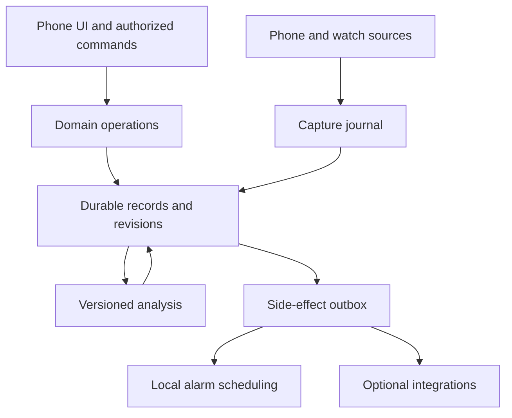

# SolSleep: research and production implementation plan

**Repository:** [BananaJeanss/solsleep](https://github.com/BananaJeanss/solsleep)  
**Research date:** 17 October 2026  
**Reference baseline:** Sleep as Android public documentation and release notes, latest documented release **20261006**. [S01] [S02]  
**Project state:** implementation started after this research baseline. See [STATUS.md](STATUS.md) for verified code, tests, and the current physical-device gate, and [docs/TRACEABILITY.md](docs/TRACEABILITY.md) for implemented subsets. The repository was empty during the initial planning pass.
**Document status:** initial engineering proposal. Implementation choices below are proposed decisions; research findings are identified separately and linked to primary sources.

## 1. Product contract

Build a free, open-source Android sleep app with the functional breadth of Sleep as Android, an original Material 3 Expressive interface, dependable alarms, durable records, and useful watch interoperability. Aim to improve transparency, recovery, accessibility, and control of personal data.

“Clone” means an independently implemented alternative with comparable useful behavior. SolSleep will have its own code, branding, artwork, recordings, models, documentation, and application ID. Reference behavior and documented interchange formats inform the requirements; proprietary implementation details are not available.

The entire app and every SolSleep-owned feature must remain usable without payment, advertising, subscriptions, a SolSleep account, or a developer-operated server. Optional integrations may require a user's existing hardware, installed app, vendor account, or external service. Those requirements must be visible before connection. A paid vendor service cannot be a hidden requirement for core functionality.

Production readiness is an evidence standard, not a label to put on an unfinished app. The release must satisfy the gates in sections 14–16. Neither a large test suite nor a feature-complete UI can establish perfect reliability, physiological accuracy, or universal device compatibility.

### 1.1 Non-negotiable outcomes

1. A saved alarm has a durable schedule, an independently scheduled deadline, a working local sound fallback, and an understandable readiness state.
2. Confirmed records and edits survive supported upgrades, interrupted imports, process death, and ordinary restarts without silent deletion.
3. A missing sensor value remains missing. An estimate is labeled as an estimate. A user correction retains its provenance.
4. Tracking, recording, and external sharing require separate, understandable choices. All-night microphone capture is optional.
5. Phone-only use works. Watch imports work where a data source exposes them. Live watch tracking is offered only for configurations actually tested.
6. The interface is comfortable at bedtime and immediately understandable while half asleep.
7. The project is buildable from source, has documented dependencies and licenses, and publishes meaningful validation evidence.
8. Feature parity remains an explicit ledger. An integration under investigation never appears as supported or complete.

### 1.2 Scope of this planning pass

This file supplies the research baseline, feature inventory, architecture, storage model, work packages, validation strategy, risks, and release criteria. It does not create an app skeleton, ship a model, install the reference application, register vendor accounts, buy hardware, or demonstrate that an alarm works on a physical phone.

The documentation inventory is broad but is not a claim that every behavior of every reference version has been observed. M0 must perform a hands-on version-specific audit and subdivide any remaining combined requirements. Keep historical, experimental, vendor-specific, and discontinued features visible rather than silently dropping them.

## 2. Research findings that change the implementation

### 2.1 Current platform and library baseline

| Finding from official documentation | Consequence for SolSleep |
| --- | --- |
| Android 17 was released on 16 June 2026; its major SDK/API level is 37. [D01] [D02] | Start with phone `targetSdk = 37` and a compile SDK meeting both API 37 and the selected dependencies' requirements. Recheck stable minor SDK requirements at M0. |
| The canonical Material 3 release page lists stable 1.4.0 and 1.5.0-beta01 dated 7 October 2026. Earlier release notes moved experimental Expressive APIs out of the 1.4 line. [D13] | Evaluate 1.5.0-beta01 for the requested Expressive components. Do not describe it as stable or assume stable 1.4.0 supplies every Expressive API. |
| Wear Compose's current canonical release page lists 1.7.1 stable and recommends the separate Wear Material 3 library. Wear guidance warns against mixing phone and watch Material components. [D14] [D15] | Use `androidx.wear.compose:compose-material3` on the watch; verify its matching artifact version and SDK requirements independently. An older dedicated Wear M3 page is not sufficient to select the current dependency set. |
| Android 17 can silently suppress background audio calls made from an invalid execution state. Alarm audio has a specific exact-alarm/`USAGE_ALARM` exemption from the additional while-in-use requirement. [D04] | Prove the alarm receiver → valid foreground execution → alarm audio path on API 37 before building secondary features. An API call returning successfully does not prove audible output. |
| Full-screen alarm access is controlled separately from normal notification permission. [D06] | Check availability, provide an in-context setup action, and test the notification fallback. Overlay access is not the default alarm architecture. |
| Edge-to-edge enforcement became stricter in Android 16; system bars, cutouts, IME, and window resizing need correct handling. [D10] [D03] | Use adaptive Compose layouts with intentional insets. Never “fix” clipping by disabling edge-to-edge or locking every screen to portrait. |
| Adaptive launcher icons support a monochrome layer. [D11] | Supply original foreground, background, and monochrome assets; use consistent monochrome symbols within the app and notifications. |

Library snapshots are a research record, not dependency lockfiles. Some source pages contain old examples or independently evolving release tables. During M0, resolve the selected artifact coordinates from official release notes and Maven metadata, verify their `minCompileSdk` requirements, and commit one compatible version catalog. Some current release notes mention SDK 37.1 for newer artifacts; its release channel and necessity must be checked before selecting it. A beta library does not justify silently requiring a preview platform.

Do not invent current Kotlin, AGP, Gradle, Room, Health Connect, or Media3 versions in this document. Select and pin a compatible supported toolchain in the first build spike, recording source URLs, checksums, and the compatibility rationale. “Latest” means a researched, tested dependency choice, not an unbounded version selector.

### 2.2 Reference behavior and documentation gaps

| Observation | Planning decision |
| --- | --- |
| The reference includes alarm scheduling, multiple CAPTCHA families, sleep tracking, audio analysis, statistics, devices, automation, and add-ons. [S01] | Treat parity as a collection of independently verifiable capabilities. |
| Its recent release notes include an AI Sleep Assistant, experimental SleepSync, Google Home integration, and native Dirigera support. [S02] | Include these in the backlog; do not use an outdated basic feature list as the definition of parity. |
| The smart-light guide says Dirigera is unsupported, while the 20260916 release notes announce support. [S32] [S02] | Record the conflict. Treat support as a newer reference capability pending hands-on confirmation, with the release date attached. |
| The documented CSV uses multiple lines per sleep record and includes special values for unavailable metrics. [S35] | Build a dedicated parser and a loss report; a generic “one CSV row equals one night” importer is wrong. |
| Reference backup methods do not universally include audio, and its guide says inactive alarms are omitted. [S34] | Improve SolSleep backup completeness: include enabled and disabled alarms, settings, and optional audio, with a readable manifest. |
| Reference wearable hooks include an application whitelist, and SleepCloud access requires approved client IDs. [S40] [S42] | Existing add-ons and cloud endpoints cannot be assumed to work unchanged with a different package. |
| Google Fit migration guidance says support ends in 2026 and new API registration has been closed since 2024. [D29] | Use Health Connect as the new mobile interoperability path. Keep legacy Fit migration distinct from promising a new Fit connector. |

### 2.3 Accuracy and watch access are separate problems

Health Connect provides stored records such as sleep sessions and associated heart rate or oxygen measurements. It is an interchange store, not a phone-to-watch live accelerometer transport or a guarantee that any vendor publishes its complete dataset. Extra access is needed for background/history reads when supported. [D16] [D17]

Wear Health Services can provide passive measurements, but batching intervals are not predictable. Capabilities must be queried. A batch delivered after waking is useful for history and unsuitable as the sole input to an imminent smart alarm. [D19] [D20]

A phone-only app cannot promise access to arbitrary raw watch sensors. SolSleep should first offer imports without a custom watch app, then add a small companion only for live acquisition, controls, and wrist alarms that require code on the watch. The reference itself uses a Wear OS companion and documents manufacturer limits on SpO₂ and HRV. [S29]

Sleep stages, breathing estimates, sleep scores, and symptom-related cues need validation beyond software correctness. The AASM consumer-technology position statement distinguishes consumer measurements from diagnosis; it is a methodological reference here, not a current legal clearance assessment. [R01] Marketing claims from the reference are not evidence that SolSleep has equal accuracy.

## 3. Proposed defaults and decision policy

| Area | Initial proposal | Revisit when |
| --- | --- | --- |
| Code license | GPL-3.0-or-later proposed for SolSleep-owned code; verify compatibility with every linked dependency, especially optional proprietary SDKs, and retain separate asset/data licenses. | Resolve incompatible linkage through a compatible license/explicit exception or a genuinely separate integration architecture before application code ships. Build flavors alone do not resolve license compatibility. This planning commit does not select a code license. [D34] |
| Phone support | `minSdk 29` proposed; target API 37. Feature availability is checked at runtime. | M0 compatibility and user-device requirements. |
| Watch support | Modern Wear OS first, provisionally Wear OS 3/API 30 and above. Pin a separate supported watch target/toolchain. | Wear dependency minimums and device survey. Do not assign phone API 37 blindly to all watches. |
| Language/UI | Kotlin, coroutines/Flow, Jetpack Compose, Material 3 Expressive. | A concrete compatibility or performance result requires a change. |
| Local data | AndroidX Room/SQLite for transactional records; DataStore for noncritical preferences. | M2 storage proof and stable library compatibility. |
| Background work | AlarmManager for alarm deadlines; foreground services for permitted active capture/playback; WorkManager for deferrable analysis/export/sync. | Platform behavior or documented service-type requirements change. |
| Network | Optional and off until a feature needs it. Core alarms, history, and tracking work offline. | Never make a network outage block an alarm. |
| Build variants | A `libre` phone build with no proprietary SDK dependency, and an optional `connected` build for Google/vendor SDK adapters. | Dependency audit establishes whether a connector can also belong in the libre build. |
| Identity | Original application ID provisionally `dev.bananajeans.solsleep`; final ownership and signing identity verified at M0. | Before first public artifact or vendor registration. |
| Cloud | File export and user-selected backup first; optional open/self-hosted sync later. | Local restore is proven and protocol/security requirements are written. |
| Monetization | No ads, paywalls, tracking SDKs, or paid SolSleep features. | This is a product constraint, not a later monetization slot. |
| Telemetry | Local redacted diagnostics; user-initiated issue bundles. | Any remote collection requires an explicit separate opt-in and documented purpose. |
| Language support | Externalized strings from the start; English baseline and Estonian release QA proposed. | Translation contributors and supported locales grow. |

No silent substitution is allowed. If a requirement needs a paid external service, unavailable SDK, restricted dataset, or hardware that has not been tested, keep the dependency visible and provide a useful local path where possible.

## 4. Feature parity ledger

**This ledger preserves the initial requirements baseline.** Current implementation and evidence are tracked in [STATUS.md](STATUS.md). The code in the last column describes feasibility and a target milestone, not completion.

- **P — planned:** a practical implementation path is identified; it still needs implementation and evidence.
- **C — conditional:** depends on a vendor, external app, OS capability, account, or tested hardware.
- **R — research:** algorithm, protocol, safety/claims, or feasibility work must succeed before support can be promised.
- **D — deliberate divergence:** an explicitly recorded behavior SolSleep will not reproduce literally.

Milestones M0–M9 are defined in section 15. Every row must eventually link to an implementation change, acceptance evidence, supported configurations, and known limits. Combined rows are families: M0 must enumerate their variants in a tracked checklist. A family is complete only when all promised variants pass.

### 4.1 Alarms and wake-up behavior

| ID | Reference capability | SolSleep execution proposal | Acceptance evidence | Class / phase |
| --- | --- | --- | --- | --- |
| A01 | One-time and repeating alarms. [S03] | Persist schedules and generate uniquely identified occurrences. | Date/weekday fixtures and real-device firing. | P / M1 |
| A02 | Odd/even weeks and interval repeats. [S03] | Explicit week-number convention, anchor date, and interval unit. | Year boundaries and skipped-instance tests. | P / M1 |
| A03 | Skip next, next-date override, temporary changes. [S04] | Store an occurrence exception without mutating the recurring rule. | Next occurrence changes once; following recurrence stays correct. | P / M1 |
| A04 | Global defaults and per-alarm settings. [S03] | New alarms copy a documented defaults snapshot; explicit per-alarm values are durable. | Changing defaults has predictable effects and never silently changes an existing critical alarm. | P / M1 |
| A05 | Smart wake-up window. [S05] | Local online decision policy with a prearmed latest deadline. | Sensor loss, slow analysis, and race tests never postpone the deadline. | P / M3 |
| A06 | Sleep-goal constraint and ideal wake time. [S04] [S05] | A constrained window with visible conflict resolution. | Goal cannot override a fixed deadline without an explicit user choice. | P / M4 |
| A07 | Nap timer and power nap. [S10] | Separate fixed-duration and minimum-rest-plus-window policies. | All displays and triggers agree on the latest ring time. | P / M3 |
| A08 | Multiple daily/polyphasic schedules. [S01] | Generic recurrence supports several daily rest periods without health-benefit claims. | Overlapping occurrences have deterministic ownership. | P / M4 |
| A09 | Snooze controls. [S06] | Count, total-duration, diminishing-duration, selectable-duration, and deadline rules. | Boundary and repeated-receiver tests. | P / M1 |
| A10 | Backup escalation and wake-up check. [S07] [S08] | Durable escalation timers and a later acknowledgement/re-ring flow. | Restart during every transition; no duplicate or lost timer. | P / M1 |
| A11 | Gradual sound, delayed sound, vibration, screen sunrise. [S03] | A local wake-up timeline with independent output stages. | Audio/haptic/light timing and cancellation measured. | P / M1 |
| A12 | Local tones, playlists, radio, silent alarms. [S09] | Local tone always available; stream selection has a preconfigured local fallback; silent mode remains an explicit user choice. | Missing URI, decode error, no internet, and intentional silence cases. | P / M1–M6 |
| A13 | Spotify alarm/lullaby playback. [S09] [S23] | Optional App Remote adapter; never use it as the only dependable wake-up output. | Authorization, app-not-installed, stale session, and fallback tests. | C / M7 |
| A14 | Spoken alarm details and time entry. [S03] [S04] | Local TTS where available; keyboard and accessible picker remain complete. | Missing voice engine or speech service leaves the alarm usable. | P / M4 |
| A15 | Sunrise-based alarm time. [S04] | Local astronomical calculation using an entered place or optional location. | Polar day/night and date/zone boundaries; explicit fallback time. | P / M4 |
| A16 | Bedtime reminder and sleep-mode changes. [S01] | Reminder derived from next occurrence and chosen goal; optional app-owned DND rule. | User changes during a night are preserved on restore. | P / M4 |
| A17 | Flip/button/long-press alarm actions. [S03] | Configurable actions with clear previews and accessible equivalents. | Lock screen, accidental taps, and unavailable keys tested. | C / M4 |
| A18 | Full-screen and lock-screen alarm. [S03] | Platform alarm notification and full-screen intent, subject to system access. | API-specific permission denial, lock state, and fallback checks. | C / M1 |
| A19 | Stop tracking/delete one-shot after dismissal. [S03] | Idempotent finalization command; alarm template and occurrence lifecycle stay distinct. | Double dismissal cannot delete history or stop another session. | P / M2 |
| A20 | Monetized wake-up motivation; shutdown/uninstall resistance. [S08] | Offer nonmonetary commitments and wake checks. Do not offer wagering or promise to defeat force-stop, power-off, or system controls. | Label the differences in parity reporting; ordinary uninstall remains available. | D / M4 |

### 4.2 Wake-up task families

The reference task catalogue includes math, visual search, scanning, motion, voice/camera, games, memory, text, and chained tasks. [S08] SolSleep implements the interaction families using original assets and code. No task may leave an alarm permanently impossible to dismiss because a sensor, permission, language, or external app became unavailable.

| ID | Coverage | SolSleep execution proposal | Acceptance evidence | Class / phase |
| --- | --- | --- | --- | --- |
| C01 | Choice and typed math. [S08] | Generated tasks with persisted seeds and bounded difficulty. | Unique valid solutions and restart-stable progress. | P / M4 |
| C02 | Visual search and original sheep-style search equivalent. [S08] | Original scene with nonvisual alternative. | Target always exists; large text and TalkBack do not trap dismissal. | P / M4 |
| C03 | QR/barcode and NFC. [S08] | In-app scanning and learned nonsecret token hashes; local fallback. | Missing tag, revoked camera, unsupported NFC, and lock-screen tests. | C / M4 |
| C04 | Shake, spin, walk, and brightness tasks. [S08] | Calibrated local sensor challenges with accessible substitution. | Simulated noise/false motion, sensor absence, and cancellation tests. | C / M4 |
| C05 | Smile, laughter, and loudness tasks. [S08] | Optional on-device detectors or energy thresholds; store no camera/audio content by default. | Permission loss and detector uncertainty cannot strand the alarm. | R / M8 |
| C06 | Maze and jumping game equivalents. [S08] | Small original deterministic games with touch alternatives to tilt. | Every generated level is solvable; interruption resumes safely. | P / M8 |
| C07 | Memory, mirror text, flags, typed phrases, distorted text. [S08] | Original prompts with locale, vision, and keyboard accommodations. | Supported scripts, validation, and content fixtures. | P / M4–M8 |
| C08 | Dream diary task. [S08] | Durable local note attached to the correct session. | Process death and minimum-length validation preserve entered text. | P / M4 |
| C09 | Multi-task and random sequences. [S08] | Compose individually validated tasks; persist sequence and progress. | Retry does not regenerate an easier sequence or double-complete a task. | P / M8 |
| C10 | At-home-only tasks and lost-code fallback. [S08] | Explicit home/travel profile first; optional coarse-location policy after permission review. | Unavailable location never invents “home”; fallback is previewed. | C / M8 |
| C11 | Third-party task extension. [S01] | Versioned SolSleep extension contract with per-app grants. | Untrusted extension failure returns to a built-in task. | C / M7 |

### 4.3 Tracking and acquisition

| ID | Reference capability | SolSleep execution proposal | Acceptance evidence | Class / phase |
| --- | --- | --- | --- | --- |
| T01 | Manual tracking, delay, pause, resume. [S01] | Durable session state machine and explicit pause/gap events. | Every transition survives restart and repeat commands. | P / M3 |
| T02 | Phone accelerometer tracking. [S13] | Timestamped sensor adapter, placement calibration, bounded sampling. | Mattress/device fixtures and screen-off overnight captures. | P / M3 |
| T03 | Contactless sonar. [S13] | Independent DSP research, device calibration, and compatibility list. | Real-device motion/respiration comparison and audio-route stress tests. | R / M8 |
| T04 | Automatic start modes and charging conditions. [S11] | Schedule/activity hints plus an OS-permitted start path; prompt when microphone access needs visible interaction. | Denial and background restrictions are visible; no secret microphone restart. | C / M3–M8 |
| T05 | Missed-night sleep-time estimate. [S12] | Separate inferred record, initially requiring confirmation. | Estimate does not acquire fabricated motion or stage samples. | C / M4 |
| T06 | Google Sleep API hints. [S11] | Connected-build adapter, never an alarm dependency. | Missing Play services or activity access leaves manual tracking complete. | C / M4 |
| T07 | Sleep/awake and onset estimation. [S01] [S14] | Transparent baseline, sensor-quality gates, versioned online/offline paths. | Subject-separated evaluation and unknown-data cases. | R / M3–M8 |
| T08 | Multi-sensor fusion and source selection. [S13] | Keep source channels separate and record every selection/fallback. | Conflicting clocks/values do not silently overwrite a source. | P / M5 |
| T09 | Partner/pair tracking. [S26] | Opt-in authenticated feature exchange; compare suppression methods before adopting one. | Independent motion, correlated motion, clock drift, and disconnect trials. | R / M8 |
| T10 | Light levels and bedroom conditions. [S13] | Optional environment channel with units and sampling metadata. | Sensor saturation, missing sensor, and permission cases. | P / M3 |
| T11 | Noise monitoring and event recordings. [S24] | One optional audio capture pipeline with storage limits. | Playback, recording, and analysis coexist without duplicate microphone owners. | P / M6 |
| T12 | Time-only/low-power mode. [S41] | Record elapsed rest and user markers without physiological claims. | Mode is labeled; no generated hypnogram appears. | P / M3 |
| T13 | Wearable start/stop and session recovery. [S40] | Correlated commands and local journals on both devices. | Reconnect and duplicate-command tests. | C / M5 |
| T14 | Sensor diagnostics and placement guidance. [S13] | Short live signal test and last-seen/quality indicators. | A dead or stale channel is immediately distinguishable from stillness. | P / M3 |
| T15 | Tracking interruption/reboot recovery. [S01] | Recover committed chunks; expose interruption and require permitted resumption. | Crash/reboot fault injection yields honest partial nights. | P / M2–M3 |
| T16 | Smart-window-only tracking. [S11] | Limited session explicitly labeled as incomplete-night coverage. | Charts cannot present the limited window as a full night. | C / M3 |

### 4.4 Measurements, history, and analysis

| ID | Coverage | SolSleep execution proposal | Acceptance evidence | Class / phase |
| --- | --- | --- | --- | --- |
| H01 | Sleep stages/hypnogram. [S14] | Preserve imported stages; label SolSleep-derived stages by algorithm and supported sensor mode. | No phone-only REM/deep claim without relevant validation. | R / M4–M8 |
| H02 | Duration, onset, awake periods, efficiency. [S15] [S17] | Interval-based definitions with coverage and correction metadata. | Hand-computed fixtures and gap-aware denominators. | P / M4 |
| H03 | Duration goal, deficit, multiple sleeps per day. [S16] [S17] | Configurable sleep-day boundary and explicit daily-versus-cumulative debt. | Naps, cross-midnight records, overlaps, and DST tests. | P / M4 |
| H04 | Sleep score and metric ordering. [S15] | Original published score specification; comparable dimensions where data permits. | Missing metrics reduce coverage rather than create a perfect score. | P / M4 |
| H05 | HR/resting HR and HRV. [S13] | Source HR metrics; derive HRV only from appropriate beat intervals or retain vendor-provided values with method labels. | No conversion of coarse HR samples into invented HRV. | C / M5 |
| H06 | Respiration and SpO₂ graphs. [S25] | Source-specific units and quality; SpO₂ only from a real supported source. | Dropout, artifact, bounds, and stale-value checks. | C / M5–M8 |
| H07 | Breathing disturbances and low-reading cues. [S25] [S31] | Research feature with transparent definitions and limited claims. | Separate signal-validation and false-alert assessment before release. | R / M8 |
| H08 | Chronotype and social jetlag. [S20] | Publish the method, work/free-day classification, missingness, and circular-time handling. | Shift-worker, travel, and sparse-history cases. | P / M4 |
| H09 | Sleep Regularity Index. [S20] | Implement a named published definition with UTC/local policy. [R04] [R05] | Independent formula fixtures; never assume unobserved daytime is awake. | P / M4 |
| H10 | Trends, ranges, zoom, filters. [S16] | Shared query layer, downsampling, accessible detail table. | Visible summaries match exports and detail views. | P / M4 |
| H11 | Tags, emoji, quantities, search, correlations. [S19] | Unicode-aware tags, typed quantities, sample counts, noncausal comparisons. | Rename/merge/undo and small-sample tests. | P / M4 |
| H12 | Ratings, notes, manual additions, trimming, awake edits. [S18] | Non-destructive revision log with absent rating distinct from zero. | Restore/undo returns original observations and derived versions. | P / M2–M4 |
| H13 | Advice, goals, achievements. [S01] | Evidence-linked rules and gentle goal feedback; avoid rewarding short sleep or surveillance. | Rules explain which records caused a suggestion. | P / M4 |
| H14 | Country/community comparison and research participation. [S17] [S01] | Only use an appropriately licensed, described comparison dataset; opt-in study export is separate. | No fabricated population average or silent data donation. | C / M8 |
| H15 | Weather, lunar, place, and contextual tags. [S19] | Local astronomical tags and optional configured context providers. | Provider failure leaves absent tags, with no inferred causal claims. | C / M7 |
| H16 | AI Sleep Assistant and voice questions. [S02] | Local deterministic explanations first; optional local/open model or user-configured endpoint. | Ground answers in selected records and reject invented measurements; no required paid API. | R / M8 |

### 4.5 Audio, cues, and bedtime tools

| ID | Coverage | SolSleep execution proposal | Acceptance evidence | Class / phase |
| --- | --- | --- | --- | --- |
| N01 | Snoring, speech, cough/sneeze, baby crying, laughter. [S24] | On-device event classification with confidence, labels, and per-class controls. | Held-out recordings, false events/hour, and partner/background-audio tests. | R / M6 |
| N02 | Recording review, favorites, export, retention. [S24] [S02] | Segment-linked player, clip controls, and independent audio deletion. | Missing/corrupt clip cannot corrupt the night or prevent deletion. | P / M6 |
| N03 | Anti-snoring audio, haptics, light cues. [S22] | Off by default; preview, cooldown, intensity cap, and disable control. | False-positive storms cannot create an unlimited cue loop. | R / M6 |
| N04 | Lucid-dream cues and dream diary. [S21] | Configurable scheduled/estimated cues with honest source labels. | An inferred phase is never represented as measured REM. | R / M8 |
| N05 | Ambient sounds, nature loops, custom tracks. [S23] | Original/licensed assets and procedural white/pink/brown noise. | Seamless-loop and long-run playback tests. | P / M6 |
| N06 | Sleep timer, fade, playlists, stop-on-sleep. [S23] | Local player timeline; sleep-triggered fade uses confidence and manual override. | Focus changes, headphones removed, pause, and alarm preemption. | P / M6 |
| N07 | Guided relaxation and TTS. [S23] | Original scripts, local TTS adapter, readable text alternative. | Locale/engine availability and interruption checks. | P / M6 |
| N08 | Binaural audio options. [S23] | Optional audio synthesis, clearly separated from proven therapeutic outcomes. | Frequency, channel, volume, and route validation. | R / M8 |
| N09 | External media stop/control. [S23] | Only control an app through its supported authorized media interface. | Access revocation and apps that reject commands. | C / M7 |
| N10 | Jet-lag light scheduling. [S43] | Begin with a local travel/schedule planner. Investigate light-pulse behavior separately. | No clinical efficacy or precise flash-duration claim without hardware measurement. | R / M8 |

### 4.6 Devices and interoperability

| ID | Coverage | SolSleep execution proposal | Acceptance evidence | Class / phase |
| --- | --- | --- | --- | --- |
| W01 | Stored watch sleep and vitals. [S33] | Health Connect import by selected source, with provenance. | Real exports from selected vendor apps and duplicate handling. | C / M5 |
| W02 | Live Wear OS movement and HR. [S29] | Minimal companion, capability probing, buffered transport. | Two vendors, disconnects, screen-off, and full-night tests. | C / M5 |
| W03 | Watch haptics and alarm controls. [S29] | Acknowledged commands plus optional watch-local alarm occurrence. | Phone-offline test; bedtime-mode restrictions reported. | C / M5 |
| W04 | Watch SpO₂/HRV. [S28] | Only expose actual supported channels or stored imports. | Per-model evidence; no generic “all watches” badge. | C / M5–M8 |
| W05 | BLE HR straps/Polar. [S28] | Standard services first, optional documented vendor adapter for richer signals. | Packet decoding, reconnection, RR units, and real hardware. | C / M5 |
| W06 | BLE oximeters. [S31] | Per-protocol adapters; do not assume a product name implies standard GATT support. | Specific firmware/model captures and invalid-packet fixtures. | C / M8 |
| W07 | Garmin. [S30] | Feasibility spike for an independent Connect IQ bridge and available imports. | Watch-model and overnight transport validation. | C / M8 |
| W08 | Pebble/Rebble/Gadgetbridge. [S02] [S28] | Investigate documented bridge contracts and implementation licenses. | Bridge version, payload, and physical-device test. | C / M8 |
| W09 | Xiaomi/Mi Band/Amazfit/Huawei bridges. [S28] | Health Connect where available; evaluate independent compatible bridge APIs. | No assumption that a Sleep-as-Android-specific add-on accepts SolSleep. | C / M8 |
| W10 | Legacy Tizen/Gear/older Android Wear. [S01] | Inventory legacy paths; offer import-only support if live code cannot be maintained. | Explicit tested-version list or a documented unsupported row. | C / M8 |
| W11 | Sleep Phaser/PIR and sleep mask. [S13] [S32] | Protocol and licensing investigation; user-owned hardware only. | Device acquisition, protocol fixtures, and stop/fallback behavior. | R / M8 |
| W12 | Smart lights: Hue, Trådfri, Dirigera, Google Home. [S32] [S02] | Local/open bridge where possible; optional vendor adapters and MQTT path. | Per-hub testing and production-access checks. | C / M7–M8 |

### 4.7 Backup, automation, and platform surfaces

| ID | Coverage | SolSleep execution proposal | Acceptance evidence | Class / phase |
| --- | --- | --- | --- | --- |
| I01 | Full backup and restore. [S34] | Versioned portable archive; optional audio; disabled alarms included. | Restore in a clean installation and semantic comparison. | P / M2 |
| I02 | Reference CSV migration. [S35] | Dedicated streaming parser, preview, deduplication, and import report. | Real sanitized multi-line exports and malformed-file tests. | P / M2 |
| I03 | Cloud storage/Drive/Dropbox. [S34] | User-selected document provider first; native OAuth connectors only if needed. | Expired access, full quota, partial upload, and key recovery. | C / M7 |
| I04 | SleepCloud compatibility. [S42] | Optional import only if vendor access is actually granted. | Allowlist, scopes, API availability, and mapping verified. | C / M8 |
| I05 | Experimental SleepSync and cross-device sync. [S02] | Investigate reference behavior; design an independent open sync protocol. | Conflict, tombstone, offline edit, and recovery tests. | R / M8 |
| I06 | Health Connect read/write. [S33] | Typed permissions, own-record identifiers, changes and deletion handling. | No loops, source overwrites, or duplicate nights. | C / M5 |
| I07 | Legacy Google Fit / Samsung Health. [S01] | Prefer current Health Connect pathways; research direct vendor access only where needed. | Honest capability list; no new Fit dependency. | C / M7 |
| I08 | Tasker/Automate and Intent API. [S36] [S41] | Stable SolSleep actions and per-client control grants. | Unauthorized alarm disable/export requests rejected. | P / M7 |
| I09 | Custom webhooks. [S37] | Versioned event JSON, redaction controls, signed delivery option, retry queue. | Duplicate/replayed/expired event fixtures and unreachable endpoint. | P / M7 |
| I10 | MQTT / Home Assistant / IFTTT. [S36] [S38] | Document open broker/webhook recipes; optional service-specific adapters. | QoS/retry semantics and event expiry tested. | C / M7 |
| I11 | Calendar skips, rescheduling, sleep export. [S39] | Selected calendars, visible proposed changes, durable undo, and deduplicated exports. | Event edits, time-zone changes, and revoked permissions. | C / M7 |
| I12 | Assistant/App Actions and system alarm intents. [S01] [S02] | Implement supported standard alarm/start interfaces; research newer App Functions separately. | Structured validation and current platform compatibility. | C / M7–M8 |
| I13 | Developer data/task APIs. [S01] | Permission-scoped provider/extension API with a versioned schema. | Third-party contract fixtures and access isolation. | P / M7 |
| I14 | Dashboard, history, alarm-only mode. [S01] | Three coherent destinations with configurable home view. | Complete core workflows with no placeholder screens. | P / M0–M4 |
| I15 | Widgets, shortcuts, quick actions. [S27] | Next alarm, bedtime, tracking, recent-night graph, add-alarm and nap actions. | Launcher/resize/theme/API 37 RemoteViews memory testing. | P / M4 |
| I16 | Personalization, language, search, privacy settings. [S01] | Shared design tokens, per-app locale, structured settings search. | RTL/large text, process recreation, and deep-link tests. | P / M4 |
| I17 | SleepCloud study/community features. [S01] | Optional independent research export or licensed comparison data only. | Separate opt-in, complete export preview, no implicit upload. | C / M8 |

### 4.8 What counts as parity

Do not publish a single percentage that conceals conditional or research rows. Report counts by family and classification, with links to test evidence and each dependency. A complete reproduction claim would require all reference-observable capabilities to be accounted for; the explicit divergences above mean “100% identical” would be inaccurate even after every planned feature ships.

A first dependable production release may have a smaller advertised scope. It must be named and documented as that scope, while this ledger retains the broader objective. No synthetic data, inactive settings, “coming soon” controls, or mocked integrations may be shown as working features in that release.

## 5. Architecture and repository organization

Use one repository with a phone app, shared domain libraries, and an optional watch application module. A watch module is a small deployment target for sensors and controls, not a separate product with duplicated history, settings, and analytics.

Start with enough separation to isolate reliability boundaries. Do not create a module for every screen or introduce a remote backend merely to make the architecture look substantial.

| Proposed module/path | Responsibility | Boundary rule |
| --- | --- | --- |
| `app-phone` | Activity, navigation, feature composition, Android entry points. | No physiological calculations or recurrence arithmetic in composables. |
| `core/model` and `core/time` | Typed records, identifiers, units, interval operations, clocks, recurrence policy. | Pure Kotlin where possible; no Android UI dependencies. |
| `core/data` | Room schema, transactions, file manifests, repositories, migration history. | Owns durable state; callers cannot bypass revision or deletion rules. |
| `core/alarms` | Scheduling, reconciliation, occurrence lifecycle, escalation, direct-boot projection. | Does not depend on tracking, network, an AI model, or the full UI graph. |
| `core/tracking` | Session coordinator and acquisition contracts. | Source adapters emit timestamped observations and quality, not final health conclusions. |
| `core/analysis` | Deterministic features, models, metrics, evidence/algorithm versions. | Same inputs and algorithm version reproduce the same output within documented numeric tolerances. |
| `core/audio` | Capture arbiter, local playback, audio routing, clip storage. | One microphone owner; alarm playback has priority. |
| `core/designsystem` | Theme, Expressive wrappers, icons, common accessible components. | Experimental UI APIs remain isolated from domain modules. |
| `integrations/*` | Health Connect, BLE, optional Google/vendor SDKs, calendar, automation, storage. | Each adapter has capabilities, authorization, tests, and a failure boundary. |
| `app-wear` | Optional live sensor acquisition, local queue, minimal controls, wrist alarms. | Uses shared protocol/model code; phone history remains usable without it. |
| `test-fixtures`, `benchmark`, `docs` | Synthetic fixtures, licensed sample metadata, benchmarks, architecture decisions, reports. | No private real-night recordings or restricted research data in git. |

These are the intended boundaries, not a demand to create all modules immediately. M0 can begin with a few modules and split them as the first complete workflows establish the real dependency graph.

Use unidirectional UI state, ViewModels, cancellable structured concurrency, injected clocks/schedulers, and explicit result types at integration boundaries. Choose the dependency injection mechanism during M0 based on build/startup cost and direct-boot behavior; critical entry points must not initialize unrelated features.

### 5.1 Ownership and event flow

`UI or authorized command → domain operation → durable transaction → scheduling/event outbox → platform adapter`.

The database records intent and the acknowledged result of side effects. SQLite cannot transact atomically with AlarmManager, Health Connect, a remote server, or the filesystem. Reconciliation repairs partial progress; a coroutine returning successfully is not the durability contract. Alarm scheduling consumes its own durable operations and never waits for the optional integration consumer.

Keep ordinary app execution in a single process initially. Acquisition, playback, import, and analysis have distinct service/worker responsibilities and bounded queues. Introduce another process only if measured isolation benefits justify the extra database, direct-boot, and lifecycle complexity.

Keep critical alarm definitions/actions in a small separately openable AlarmStore, with its own schema lifecycle and the direct-boot projection described below. Large health-history migrations must not be on the receiver/playback initialization path. Failure to append nonessential history or analytics must not prevent an already armed valid alarm from starting its local output. Test storage-full and migration-in-progress cases explicitly.

Maintain two event categories:

- **Facts:** observed samples, acknowledged user actions, committed edits, and integration receipts.
- **Derived results:** stages, scores, suggestions, and summaries linked to immutable input revisions.

An automation event can describe a committed fact or a specifically labeled estimate. A later algorithm recomputation must not replay yesterday's alarm or smart-home action.

### 5.2 Required architecture decisions

Before the affected implementation merges, write a short ADR describing the selected option, alternatives, evidence, and migration implications:

| ADR | Decision |
| --- | --- |
| ADR-001 | Code/asset licenses, application IDs, release signing identities. |
| ADR-002 | SDK/toolchain matrix, Expressive dependency channel, and adapter build variants. |
| ADR-003 | Alarm recurrence, DST, travel, overdue delivery, and clock-change semantics. |
| ADR-004 | Credential-protected data and direct-boot alarm projection. |
| ADR-005 | Applicable foreground-service types and permitted start/restart paths. |
| ADR-006 | Database schema, series chunks, durability, and retention budgets. |
| ADR-007 | Portable backup format, key recovery, and restore semantics. |
| ADR-008 | Source precedence, Health Connect deduplication, edits, and deletion. |
| ADR-009 | Watch clock alignment, queue protocol, retries, and local alarm ownership. |
| ADR-010 | Metric equations, stage naming, model validation, and missing-data policy. |
| ADR-011 | Extension authorization and automation event schema. |
| ADR-012 | Optional sync conflict resolution, encryption, and account independence. |

## 6. Time model and durable record model

### 6.1 Time must have a declared meaning

Store UTC instants for actual events plus the relevant IANA zone and observed offset. Store a recurrence's local civil time and zone policy separately. A recurring 07:00 local alarm and a one-shot alarm at an absolute instant are different objects.

Use monotonic elapsed time for in-boot durations, sensor timestamps, and latency measurement. Store a boot/session anchor connecting monotonic time to wall time, with uncertainty. A reboot starts a new anchor; never compare elapsed values from different boots directly.

Proposed defaults:

| Case | Proposed behavior |
| --- | --- |
| Recurring morning alarm | Follows the phone's current local zone unless explicitly pinned to a named zone. |
| One-shot date/time alarm | UI explicitly distinguishes a chosen local-zone appointment from a fixed instant. |
| DST gap/nonexistent local time | Advance by the transition gap and show the resolved occurrence in advance; provide a configurable alternative if the audit requires it. |
| DST overlap/repeated local time | Choose the earlier offset once per recurrence by default; persist that choice and never ring twice because the clock repeats. |
| Manual wall-clock jump | Reconcile future civil schedules; already committed occurrence identity prevents duplicates. |
| Nap countdown | Uses elapsed duration during the same boot. Reboot recovery uses a persisted deadline and visibly documented limitations. |
| Time-zone change during sleep | Preserve all source instants, record the change, and recompute display without altering measured durations. |
| Overdue alarm after reboot/recovery | Use an explicit grace policy; never ring arbitrarily old missed alarms on restore. Show a missed-alarm record when delivery is no longer appropriate. |
| Historical charts | Assign a sleep day using a versioned boundary policy; preserve original event zones and identify a travel day. |

Do not use formatted dates as keys. Do not calculate a night as “end clock time minus start clock time.” Do not repair a bad clock by silently rewriting raw timestamps.

### 6.2 Proposed logical entities

| Entity | Essential fields/behavior |
| --- | --- |
| `AlarmDefinition` | UUID, label, enabled state, recurrence, zone policy, configuration revision, created/updated time. |
| `AlarmException` | Alarm ID, local occurrence key, skip/override rule, reason, revision. |
| `AlarmOccurrence` | Stable ID, definition revision, resolved instant/offset, earliest/latest window, lifecycle, claimed delivery generation. |
| `AlarmAction` | Occurrence ID, action ID, user/automation source, time, snooze/escalation sequence. |
| `PlatformScheduleIntent` | Desired OS registration, generation, request identity, last attempt/result. |
| `SleepSession` | UUID, start/end, state, origin, active source set, coverage, latest committed checkpoint. |
| `SourceDescriptor` | Adapter, device/model/firmware where available, channel units, calibration, permission/capability snapshot. |
| `SignalChunk` | Session/source/channel, sequence, timestamp range, sample count, format version, checksum, file/state reference. |
| `SessionEvent` | Pause, interruption, marker, cue, source switch, clock discontinuity, user action. |
| `AnalysisRun` | Input revision/hash, algorithm/model version, configuration, output version, quality and uncertainty. |
| `StageInterval` | Start/end, stage label, observed/imported/estimated origin, source/method, confidence if calibrated. |
| `SessionRevision` | User edits and provenance; raw observations remain separately identifiable. |
| `Rating`, `Tag`, `Note` | Absent values stay absent; Unicode and typed quantities supported. |
| `AudioSegment` | Clip interval, event labels, content hash, codec, byte length, retention/favorite state. |
| `ExternalRecordLink` | Provider, record type/ID/version, origin, local revision, last sync receipt. |
| `OutboxEvent` and `SyncCursor` | Durable pending side effects, idempotency key, expiry, scoped cursor and failure. |
| `DeletionTombstone` | Deleted object identity and revision; prevents later sync from resurrecting it. |
| `BackupManifest` | Format/schema version, snapshot identity, included objects/files, hashes, encryption/KDF metadata if applicable. |

Use integer timestamp/duration units with explicit conversions. Use typed physiological units. Enforce nonnegative durations, valid interval ordering, appropriate value bounds, unique external identities, and foreign-key relationships. Keep raw values flagged when implausible rather than substituting an invented normal value.

## 7. Alarm reliability design

### 7.1 Scheduling protocol

Android's alarm guide distinguishes exact alarm methods and their access requirements. `setAlarmClock()` is the starting point for user-visible wake-up deadlines. AlarmManager is the timing mechanism; WorkManager is not an exact alarm replacement. [D05]

1. Validate the user's configuration and resolve the next occurrence using an injected clock and zone database.
2. In one transaction, persist the definition/exception revision, occurrence, and desired scheduling operation.
3. Register the deadline with a unique, explicit, immutable PendingIntent whose identity contains occurrence and generation information. Do not use a colliding truncated hash as the sole identifier.
4. Record the adapter's registration result. Show “Alarm set” only after durable storage and a successful applicable scheduling call; distinguish partial/blocked setup from an armed alarm.
5. At launch, boot, unlock, app update, time/zone change, access change, and supported recovery events, reconcile desired and registered generations.
6. A receiver validates the occurrence generation and atomically claims the transition. A stale, replayed, canceled, or superseded callback becomes a no-op.
7. Start the valid alarm execution path promptly. It must not wait for analytics, a network call, a database migration of unrelated health history, or dependency injection of the tracking engine.

The OS does not provide an atomic database-and-schedule transaction. The reconciler must cover crashes before registration, after registration but before acknowledgement, and after a user edit invalidates the old PendingIntent.

For exact-alarm access, choose the appropriate permission strategy in ADR-002: the alarm-clock use case may qualify for `USE_EXACT_ALARM`; alternative distributions/eligibility may use `SCHEDULE_EXACT_ALARM`. Check current policy and actual capability rather than declaring both indiscriminately. Access loss has a visible repair path.

### 7.2 Smart wake-up never owns the only deadline

Prearm the hard latest ring time before starting tracking. Smart wake-up may request an earlier delivery only inside the selected window and only with sufficiently fresh usable data. It cannot move the deadline later.

Keep a deadline callback armed until the earlier occurrence reaches a documented delivery state. At the deadline, the callback resolves whether the alarm is already ringing, intentionally snoozed/dismissed, or still needs delivery. A “smart decision made” flag alone is insufficient evidence that playback started.

The baseline decision engine should begin with transparent movement/quality thresholds and hysteresis. More complex models require improved held-out results. Offline full-night analysis must not leak future samples into the online smart-alarm evaluation.

Power naps use a different policy: a minimum-rest boundary followed by an explicit allowed window, as described by the reference. [S10] The UI must show the final latest ring time before starting. An unconstrained “finish this sleep cycle” promise is unacceptable.

### 7.3 Occurrence lifecycle

`Scheduled → Eligible → Ringing → Snoozed / Challenge / Dismissed`, with bounded branches for `Escalating`, `WakeCheckPending`, `Missed`, and `Canceled`.

Persist transitions and their action IDs. A stop, snooze, or dismissal from a watch and phone at nearly the same time has one deterministic result. A late “snooze” for an old occurrence must not affect the next morning's alarm.

Persist the entire wake-up timeline: vibration-only lead-in, local audio ramp, screen-light ramp, challenge state, backup timer, wake-check timer, and absolute expiry. Recreating the activity must not reset challenge progress or extend an acknowledgement deadline indefinitely.

### 7.4 Audio, notifications, and fallback

| Condition | Required behavior |
| --- | --- |
| Normal local alarm | Use alarm audio attributes and a valid foreground execution state; request audio focus appropriately. |
| Android 17 background state | Verify the exact-alarm and `USAGE_ALARM` requirements and the actual foreground-service lifecycle. [D04] |
| Custom document URI lost | Use a bundled local fallback immediately; expose the failed source after waking. |
| Radio/Spotify unavailable | Start local fallback without waiting for an unbounded connection timeout. External media may join only under a documented priority policy. |
| User chose a silent/vibration-only alarm | Honor the choice; make it obvious at setup and in preview. Do not silently turn on sound. |
| Headphones/Bluetooth disconnect | Apply the user's tested route policy; default ordinary alarms to an audible local device route where supported. |
| Full-screen access denied | Deliver the permitted alarm notification and sound; show a setup limitation. |
| Notification channel disabled | Surface the actual channel status and consequences in readiness testing. |
| DND | Explain actual allowed behavior. Where supported, use an app-owned automatic rule; do not overwrite unrelated user rules. |
| Speaker hardware muted/broken | Software cannot prove acoustic output. Include a user-observed setup test and external acoustic measurement in the device lab. |

The default wake-up path needs no overlay permission, accessibility service, device-admin grant, phone-wide media access, or network permission. Request optional capabilities only for the feature being enabled.

An in-app backup alarm is an escalation mechanism, not an independent physical alarm. Device power-off, user force-stop, and some vendor restrictions remain outside the app's control. Document these as support boundaries without claiming an app can defeat them.

### 7.5 Direct Boot

Direct Boot makes device-protected storage available before the first unlock, while credential-protected history is unavailable. Alarm apps are an explicit supported use case. [D09]

Maintain a minimal device-protected projection: upcoming occurrence IDs/generations, resolved deadlines, necessary recurrence recovery information, output settings needed to ring, and a bundled tone. Sensitive notes, recordings, tokens, location history, and health metrics remain credential-protected.

Acknowledge an alarm configuration as fully protected for restart only after the required projection is written and scheduling succeeds. The projection and main store cannot share one transaction: use versioned snapshots/checksums and an explicit reconciliation protocol. Boot receivers must function without opening the health database or initializing credential-dependent libraries.

At locked boot, schedule eligible future alarms only. Do not automatically restart microphone capture or unrestricted playback from boot. At unlock, reconcile both stores without producing a second occurrence. If a custom sound/task needs protected resources, use the already described pre-unlock fallback.

## 8. Tracking, audio ownership, and service execution

### 8.1 Session state machine

`Idle → Preparing → Tracking ↔ Paused → Finalizing → Completed`.

`Preparing` can end in an actionable failure without creating a fake night. Acquisition failure can put an existing session into `Interrupted` or a clearly described degraded mode. `Recovering` reconstructs committed progress and leaves an explicit gap until legitimate capture resumes.

Implement a single coordinator with serialized commands. A start request uses an idempotency key; repeated taps and retried watch commands cannot create parallel sessions. Stop transitions once, commits the final checkpoint, releases resources, and queues derived analysis.

Register timestamped adapters behind a capability contract:

- motion: timestamp, vector/derived magnitude, actual sample rate, sensor accuracy;
- audio: frames, format, route, capture state, processing ownership;
- environment: light/noise and units;
- vitals: HR, beat intervals, SpO₂, respiration, source validity;
- imported data: vendor record times and provenance rather than a fabricated live stream.

Record intended rate and observed rate separately. Detect out-of-order samples, sequence gaps, clock discontinuities, clipping, sensor saturation, and stale values. Apply backpressure with an explicit dropped-sample counter; never hide overflow.

### 8.2 Foreground-service applicability matrix

The Android documentation requires service types and associated prerequisites. A background-start exemption does not automatically grant microphone/body-sensor while-in-use access. [D07] [D08]

| Operation | Proposed service approach | Mandatory spike/result |
| --- | --- | --- |
| User-started microphone recording/sonar | `microphone` with audio permission and a permitted visible/user-interaction start. | Screen-off capture, revocation, stop, and restart behavior on APIs 29–37. |
| Genuine connected BLE sensor exchange | `connectedDevice` when its documented prerequisites apply. | Real pairing/reconnection and permission tests. |
| Genuine health-sensor collection | `health` only when the actual use and runtime prerequisites qualify. | Verify API-specific body/health background permission handling. |
| Phone movement-only overnight sleep tracking | Investigate `health` applicability; if it does not qualify, document a legitimate `specialUse` sleep-tracking subtype and distribution review requirements. | **M0 release-critical feasibility gate.** Select a permitted implementation; do not request irrelevant high-rate/body permissions to manufacture eligibility. |
| Alarm/lullaby audio | Applicable playback foreground path with alarm/media attributes according to purpose. | Prove API 37 sound and focus with lock screen and Doze. |
| Import, backup, later analytics, network sync | WorkManager or another documented user-initiated transfer mechanism. | Cancellation/retry and workload constraints; no indefinite `dataSync` tracker. |

Do not emulate a workout merely to obtain overnight HR. Do not invent an Android “sleep tracking” foreground-service type. If the proposed start path is disallowed, change the product behavior and disclose the limitation.

Scheduled auto-start may produce a notification requesting a tap before microphone capture. An exact alarm alone is not a universal microphone permission bypass. Recording must never resume invisibly after revocation or a reboot.

### 8.3 Audio pipeline

Use one capture owner feeding bounded consumers for event detection, optional recording, and independent sonar research. Resampling, filters, and timestamps are specified once. Capture and local playback must handle route/sample-rate changes, audio focus, a competing microphone owner, interruptions, and OS privacy toggles.

Alarm output outranks lullaby, anti-snore, and lucid cues. Sonar must stop or adapt when the speaker/microphone route no longer meets calibration. Mark the resulting gap instead of presenting a flat “perfectly still” signal.

Continuous audio retention is not the default. The initial design keeps features in memory and stores only opted-in event clips with bounded pre/post-roll and retention. Users can opt out of clip storage while using permitted on-device event analysis. Never upload room audio as an unnoticed side effect of an assistant or diagnostic report.

### 8.4 Automatic tracking and recovery

Use schedule, charging, activity hints, and supported vendor events as inputs to a visible policy. The Google Sleep API is a Play-services-dependent optional hint source, not SolSleep's sole automatic-tracking implementation. [D28]

Distinguish:

1. A known scheduled bedtime.
2. A hint that the phone owner may be asleep.
3. An active capture session with actual data.
4. A retrospectively suggested sleep interval.

These produce different record origins and UI labels. A retrospective suggestion cannot retroactively provide a real-time smart wake-up decision.

Restart should recover records first, then resume only legally available sensors. When resumption needs user interaction, retain the partial night and show a repair action. Repeated failure must back off rather than spin a service restart loop.

## 9. Persistence, recovery, import, and backup

### 9.1 Durability contract

Confirmed alarm edits and session corrections are committed before success is shown. Samples are checkpointed in small batches; raw high-rate data belongs in versioned chunks, not millions of unrelated UI rows.

Initial engineering targets, to be measured and revised transparently:

| Data | Proposed maximum uncommitted tail | Qualification |
| --- | --- | --- |
| Confirmed alarm/configuration action | No acknowledged action lost in the tested supported failure model. | Database, direct-boot projection, and OS registration have explicit acknowledgement semantics. |
| Motion/vital samples | At most 5 seconds during active capture. | Includes flushing policy and real filesystem measurements, not only in-memory callbacks. |
| Optional encoded audio | At most one 30-second in-progress segment. | A corrupt unfinished segment cannot damage earlier clips. |
| Imported records | No partial publish of an unvalidated record or selected import batch. | Large imports stage separately and publish a committed manifest. |
| External/watch events | No deletion from the sending journal before the receiving side durably acknowledges. | Replays are idempotent; storage exhaustion is reported. |

These are recovery-point objectives for defined faults, not a promise against destroyed storage or an OS/hardware failure that loses previously acknowledged writes.

Evaluate SQLite journal/synchronization settings under real storage latency and power-loss simulation. Keep critical alarm transactions small. Never weaken durability merely to satisfy a microbenchmark.

### 9.2 Chunk commit protocol

1. Append/write a new uniquely named staging chunk with header, format version, sample count, sequence, and checksum.
2. Flush the file according to the measured durability policy.
3. Publish it with an atomic same-filesystem operation where supported and commit its database reference/state.
4. On recovery, scan only the staging/manifest scope, verify headers/checksums, and reconcile orphan or incomplete files.
5. Preserve earlier valid chunks. Record any unrecoverable tail as a gap and expose diagnostics.

The file and database operations are not one transaction. Their ordering and recovery rules must be tested at each interruption point. Keep pending references distinguishable from readable committed chunks.

Enforce retention separately for derived caches, raw signals, ordinary clips, and favorites. Never delete favored audio or primary records under the label “clear cache.” Storage forecasts use observed bytes/hour and available space, not a universal phone-independent estimate.

When space becomes low, prioritize alarm state and session metadata, reduce/stop optional recording, checkpoint what can be saved, and report the actual capture gap. A full disk must not be handled with destructive database recreation.

### 9.3 Migration and rollback

Export every database schema to git. Test every supported release-to-current migration with realistic old records and complete data assertions; schema validation alone is insufficient. Android's Room guidance explicitly warns that destructive fallback deletes data. [D23]

Production code must not call destructive migration as a recovery strategy for user records. If migration fails, retain the original file, stop writes safely, and provide a recoverable diagnostic/export path.

Use additive migrations when possible. Take a consistent recovery snapshot before high-risk transformations. Test the space required for that snapshot; insufficient space must abort safely before replacing the original.

A binary rollback is not automatically a schema rollback. Define a compatibility window or require restoration from a validated snapshot, and document which app versions can open each archive/schema. Do not claim downgrades are safe merely because upgrading passed.

### 9.4 Reference importer

The reference CSV defines record header/value lines and optional noise data, time-zone information, and unavailable-value sentinels. [S35] Implement it as a streaming state machine.

The import workflow is `choose file → inspect/validate → preview → select policy → stage → commit → report`.

Requirements:

- Handle quoted fields, embedded commas/newlines, BOM/encoding variants, units, manual records, and variable record shapes.
- Preserve original identifiers, source version if known, and unrecognized fields in an import envelope when safe.
- Map unavailable sentinels to typed absence; distinguish disabled detection from detected zero.
- Parse source times/zone/offset explicitly; ask for a zone only when truly missing or inconsistent.
- Match duplicates by source record identity and content/revision, not rounded start time alone.
- Keep ambiguous overlaps visible; do not merge two legitimate naps without a rule.
- Report accepted, skipped, duplicated, partial, and rejected records, including field-level losses.
- Keep import reversible through an import-batch identity and revision log.
- Never execute archive contents or follow absolute paths, parent traversals, symlinks, or arbitrary content URIs supplied inside a file.
- Enforce entry-count, decompressed-size, nesting, duration, and sample-count limits.
- Validate reference audio/metadata import separately; CSV does not imply all sounds or settings are recoverable.

Obtain sanitized representative exports with consent during M2. Do not assume generated fixtures alone establish compatibility with the real app.

### 9.5 SolSleep archive and restore

Use a documented, versioned container containing a manifest, portable structured records, all alarm definitions, exceptions/settings, required analysis metadata, and optionally audio/raw chunks. A readable export must remain possible independently of SolSleep's backend.

A logical snapshot or supported SQLite backup mechanism must be consistent with active WAL writes; copying only the database's main file is not a valid live backup. Record exactly what the snapshot includes and excludes.

For encrypted archives, use an established authenticated-encryption implementation and reviewed key-derivation/format design. ADR-007 must specify password recovery expectations, key loss, resource limits, authentication failures, and format evolution. An Android Keystore-only key cannot be the only way to decrypt a portable backup after reinstalling or changing phones.

Restore must:

1. Validate format, authentication where applicable, hashes, versions, and limits before altering live data.
2. Stage in a separate location with a space budget.
3. Show record counts and conflict policy.
4. Keep an independent recovery snapshot or use an atomic publish strategy.
5. Commit records and file manifests consistently.
6. Restore alarm definitions but require a visible review before arming restored alarms; never replay old occurrences.
7. Recheck device-specific permissions, routes, URIs, watch pairing, and credentials.
8. Compare logical records, file hashes, and missing-data semantics with the source snapshot.
9. Report skipped/unavailable content and retain the prior database if publication fails.

Backup UX must include “last attempted,” “last successful,” destination availability, audio inclusion, and a test-restore action. A local app-private export is not an off-device backup; use a user-chosen document destination when portability is intended. Storage Access Framework supports this without broad filesystem access. [D27]

### 9.6 Deletion

Deleting a night removes or schedules deletion of its raw signals, derived results, recordings, and applicable external records according to the user's selected scope. Keep sync tombstones long enough to avoid resurrection.

Local deletion cannot recall a file the user already exported or an immutable old backup. Make backup retention and external deletion status visible. A failed provider deletion remains a reported retryable operation, not a success toast.

## 10. Wearables and Health Connect

### 10.1 Deliver useful watch support in two layers

**Import layer:** read whatever sleep/vital records the user's selected vendor app actually writes to Health Connect. This requires no SolSleep watch app. Offer source selection, sync status, source/method labels, and missing-channel explanations. It cannot provide live movement or guarantee immediate post-wake availability.

**Live layer:** install the optional SolSleep Wear OS component for movement acquisition, supported HR, controls, and wrist alarms. Keep its UI limited to connection status, permissions, start/pause/stop, next alarm, and test vibration. Do not duplicate phone analytics.

Health Services is appropriate for supported passive measurements; it does not promise dense, timely raw accelerometer batches. Use SensorManager for actual motion where permitted and measure the battery cost. Never keep an exercise session open as a hidden way to obtain sensor access.

### 10.2 Capability and compatibility model

For each device, record:

| Field | Meaning |
| --- | --- |
| Device/firmware/OS/app versions | The exact tested combination. |
| Connection path | Health Connect, Wear Data Layer, BLE, or documented bridge. |
| Channels | Motion, HR, beat intervals, SpO₂, respiration, vendor stages. |
| Availability | Supported, permission-blocked, absent, delayed, experimental, or untested. |
| Latency and coverage | Measured batch delay, gap frequency, and sample-rate distribution. |
| Alarm output | Supported haptics/audio, bedtime-mode behavior, and local independence. |
| Energy | Percentage-point drain over a declared duration and starting condition. |
| Evidence | Test report, date, sample trace, and known failure cases. |

The existence of a hardware sensor is not proof that third-party apps can read it. Show “not exposed by this device/API” instead of displaying an empty zero-valued graph.

### 10.3 Phone/watch protocol

The official Data Layer belongs to Google Play services and has connection/availability constraints. Its clients differ: MessageClient is best effort without built-in retry, DataClient persists items, and ChannelClient provides a connection-oriented stream. [D21] [D22]

Use:

- `MessageClient` for low-latency requests/acknowledgements while connected.
- A persistent local watch journal plus explicit acknowledgements for actual data safety.
- `DataClient` for small synchronized state/manifests where its semantics fit.
- `ChannelClient` or bounded assets for chunk transfer, with resumable chunk identities at the application layer.

Every envelope carries protocol version, session/occurrence ID, source ID, boot identity, sequence number, monotonic range, wall-clock anchor and uncertainty, payload type/units, checksum, and schema version. Acknowledgements refer to durably stored sequences. Keep transferred chunks until acknowledged; bound queue growth and expose storage exhaustion.

Pairing, trust, package/signature requirements, and allowed nodes are validated. A random nearby node cannot issue alarm-control commands. Old commands have expiry and occurrence identity. Negotiating a newer protocol must not cause the older app to reinterpret incompatible bytes.

Do not assume watch and phone clocks agree. Estimate offset/round-trip uncertainty periodically, preserve original times, and mark low-confidence alignment. Algorithms cannot convert transport arrival times into measurement times.

Google's transport can use service-mediated paths; do not promise all connected-build traffic stays on local Bluetooth. Document transport behavior and prefer appropriate nearby-node interactions. The libre phone build must still run without this proprietary transport SDK.

### 10.4 Disconnection and watch-local alarm policy

The phone owns its alarm occurrence and always retains its deadline. For a supported watch-local alarm, provision a correlated occurrence in advance and make independent behavior explicit to the user.

Do not assume a late remote command can wake the watch at the right time. If offline wrist alarms are promised, prove the watch scheduler, reboot behavior, haptics, audio where relevant, and bedtime-mode behavior independently.

When contact is lost:

- Phone alarm continues from its local state.
- Watch capture continues within its tested permissions/storage budget.
- Phone shows a live-source gap and uses a documented alternate source only if available.
- Reconnection replays buffered samples, not old audible cues.
- A phone/watch acknowledgement race has a deterministic outcome, with stale commands rejected.
- A watch that cannot provide reliable local vibration is labeled accordingly rather than treated as a dependable backup.

### 10.5 Health Connect synchronization

Use SolSleep's datastore as its canonical local record. Preserve provider record IDs, data origin, last-modified/version information, and links to local revisions. For SolSleep-owned exports use stable `clientRecordId` values and increasing `clientRecordVersion` values. [D18] [D33]

Keep per-type cursors and process upserts/deletions idempotently. Commit an imported page and its next cursor together locally. If a process dies after reading but before committing, replay safely. If a token expires, perform a bounded permission-aware rescan with identity-based deduplication.

Read only requested types; history and background read availability need separate checks. The default historical boundary is tied to permission grant timing, not a universal assumption that all data is limited to a rolling 30-day window. [D17] A missing history permission should produce a precise explanation and an option to continue with the available range.

Never automatically re-export imported vendor data under SolSleep's identity. Never modify or delete another app's records as if they were owned by SolSleep. User corrections overlay imported observations locally; any separate corrected export requires an explicit policy and clear provenance.

A physically overlapping interval is not sufficient to call two records duplicates. Present alternative sources and choose a preferred view while retaining the originals. This also prevents double counting phone and watch nights.

## 11. Algorithms, metric definitions, and validation

### 11.1 Observation versus inference

| Data class | Allowed interpretation |
| --- | --- |
| Recorded sensor sample | A sensor reported this value at this time, with known source/quality. |
| Imported vendor stage | The named vendor assigned this stage; it is not SolSleep's independent measurement. |
| Manual interval/correction | The user reported or edited this interval. |
| Phone-derived sleep/awake | An estimate from the named algorithm and supported phone placement. |
| Phone-derived light/deep/REM | Research output until relevant validation supports these labels. |
| Score/advice | A defined summary or suggestion, not a physiological measurement. |
| Missing interval | Unknown. No line interpolation may silently become evidence of sleep or normal breathing. |

Do not use visually precise stage charts to conceal uncertainty. At first release, phone-only tracking can show movement, rest intervals, estimated sleep/awake, and coverage even if richer stage classification is not ready.

### 11.2 Establish a transparent baseline

Begin with deterministic, inspectable signal processing: orientation-tolerant motion features, windowed activity, artifact handling, quality masks, and an explicit sleep/awake rule. Record calibration and parameters.

Compare candidate improvements against this baseline. A more complex ML model must improve a preregistered evaluation metric without unacceptable battery, latency, fairness, or calibration regressions. A model that looks impressive on training nights is insufficient.

Maintain separate online and offline pipelines:

- Online decisions see only past/current data and have a bounded computation deadline.
- Offline summaries may use the full night, but remain tied to input/model versions.
- Reanalysis creates a new derived revision, with a comparison and undo/selection policy.
- A model update does not silently rewrite the raw night, user corrections, or previously exported facts.

### 11.3 Publish metric equations before implementation

| Metric | Required specification |
| --- | --- |
| Recording/rest window | Which start delay, pauses, and finalization periods are included. |
| Time in bed | Whether user-reported/estimated boundaries are used; distinguish it from recording duration. |
| Estimated total sleep time | Union of eligible estimated sleep intervals; overlaps are not counted twice. |
| Awake time and onset | Rules for pre-onset rest, interruptions, pauses, final awakening, and unknown intervals. |
| Efficiency | Numerator/denominator, required coverage, and when it is unavailable. |
| Snoring fraction | Whether the denominator is covered audio time or estimated sleep time; show both if useful. |
| Daily deficit | Goal minus qualified daily sleep, with an explicit sign convention and inclusion of naps. |
| Cumulative debt | Sum over a selected horizon, distinctly named from mean daily shortfall. |
| HR summaries | Source, artifact mask, aggregation, minimum coverage, and distinction between measured night HR and vendor resting HR. |
| HRV | Interval unit, filtering, RMSSD/SDNN or vendor method, minimum valid window, and coverage. |
| Respiration/oxygen | Measured versus estimated source, calibration, artifacts, and missing-value treatment. |
| Chronotype/social jetlag | Defined work/free days, circular midpoints, travel treatment, and any debt correction. |
| SRI | Named published equation, sampling grid, observed state coverage, 24-hour alignment, and UTC/local variant. |
| Overall score | Input dimensions, weights, targets, missingness, version, and confidence/coverage display. |

Implement SRI from its published definition, not “percentage of nights near a preferred bedtime.” The methodological literature discusses a theoretical range of −100 to 100, despite its usual practical presentation as 0–100. [R04] [R05] Preserve a raw value and document any UI transform. Full-day coverage matters: an overnight tracker cannot silently label every untracked afternoon awake.

Reference score thresholds and clinical-sounding categories are reference behavior, not validated defaults for SolSleep. Use user-set goals and supported wellness explanations. Publish any age-dependent target rationale and avoid collecting a full birth date when an optional age range suffices.

### 11.4 Dataset and evaluation plan

DREAMT provides wearable signals and annotated sleep-stage labels from 100 participants, but access and use are governed by a restricted health-data license. It is a research candidate, not a dataset that can be copied into this public repository or automatically assumed usable for distributable models. [R02] [R03]

Before using any dataset/model/assets, record provenance, version, channels, labels, subject population, permitted use, redistribution/model-release restrictions, and access conditions. If access is not granted, continue with synthetic protocol tests and appropriately consented data; do not invent a successful validation.

Evaluation requirements:

1. Split by participant before feature fitting, normalization, threshold selection, or augmentation.
2. Separate training, development, and untouched test partitions; keep repeated nights from one person together.
3. Evaluate each sensor/placement mode separately. Wrist accelerometry validation does not validate mattress-phone motion or sonar.
4. Include quiet wakefulness, interrupted sleep, naps, different mattresses/phone placements, partner movement, pets, and device dropout.
5. Report class balance, exclusions, coverage, and the number of participants/nights.
6. For sleep/awake: sensitivity, wake specificity, balanced accuracy, confusion matrix, sleep-duration and wake-after-onset error, with participant-level confidence intervals.
7. For stages: per-class precision/recall/F1, macro-F1, confusion matrix, agreement statistic where appropriate, and abstention/coverage. Do not hide weak REM performance behind overall accuracy.
8. For audio: event-level precision/recall, false events/hour, overlap matching rule, per-category performance, and room/source ambiguity.
9. For breathing: signal-quality/coverage, rate error against an appropriate synchronized reference, artifact rejection, and false alert rates.
10. For smart alarms: delivery compliance and prospective user-experience outcomes are separate endpoints. Software accuracy does not establish better waking experience.
11. Publish exact preprocessing, held-out protocol, model/config hashes, and reproducible evaluation scripts where licensing permits.
12. Keep raw research data outside git; publish aggregate results and authorized artifacts only.

Set numeric accuracy release thresholds after the baseline and available evidence are understood, before evaluating the final held-out set. Do not manufacture a “95% accurate” target without defining task, ground truth, coverage, and population.

### 11.5 Sonar and advanced cue research gates

Sonar work needs its own feasibility package:

- Identify usable speaker/microphone bandwidth and test routes on each target model.
- Measure stationary baseline, body/respiration motion, blankets, distance/angle, partner interference, room acoustics, and external noise.
- Detect unsupported routes or calibration failure and refuse misleading output.
- Account for coexistence with lullabies, alarms, audio recording, and OS processing.
- Measure energy, thermal behavior, and actual sound spectrum; “ultrasonic” is not a substitute for testing audibility.
- Compare an independent implementation against synchronized appropriate ground truth.
- Review method, code, model, and dependency provenance before distribution.
- Keep this mode experimental until both signal and device evidence pass.

Partner filtering must not simply subtract arbitrary unsynchronized traces and call the result accurate. Compare alternative methods against labeled independent/correlated movements, retain unfiltered observations, and measure when filtering harms results.

Anti-snoring, lucid-dream cues, low-reading notifications, binaural audio, and jet-lag light features remain off by default until their intensity, false-trigger, accessibility, and interruption behavior is assessed. A configurable wellness notification must not be described as emergency monitoring or an apnea diagnosis.

Precise light pulses require measured actuator timing. A generic smart bulb or phone torch API cannot be assumed to reproduce a research protocol's pulse duration.

## 12. Human interface and Material 3 Expressive

### 12.1 Information architecture

Build around three primary destinations: **Tonight**, **History**, and **Alarms**. Settings and optional analysis live behind predictable entry points. An alarm-only home mode changes the landing view without creating a second implementation of alarms.

| Surface | Real user outcome |
| --- | --- |
| Tonight | See the next alarm/deadline, selected source, readiness, and one clear “Start tracking” action. |
| Alarm editor | Set the time first, then optional behavior; immediately see the next resolved date and any setup blocker. |
| Tracking | Quiet elapsed time, active source, gaps/quality, pause/stop, markers, and sound controls. |
| Ringing alarm | Large readable time/label, stable snooze/dismiss actions, task progress, and understandable fallback. |
| Morning summary | Confirm/correct boundaries, optionally rate/tag, see coverage, and save without answering every prompt. |
| History | Search and filter actual sessions; distinguish imported, manual, partial, and estimated records. |
| Night detail | Intervals, source labels, notes, audio events, and edit history. |
| Trends | Consistent units and ranges, visible data sufficiency, accessible table/detail alternative. |
| Device setup | Explain import versus live connection, test a signal/haptic, and show exact missing capabilities. |
| Data and privacy | Retention, export, backup status, restore, connected destinations, and deletion. |

No technical module names, permission constants, model internals, or debugging terminology belong in a normal user flow unless they help a concrete choice. Developer details belong in optional diagnostics.

### 12.2 Expressive design system

Use the phone Material 3 Expressive components/theme available in the selected researched dependency, with limited explicit opt-ins. Compose wrappers isolate unstable APIs. On Wear, use the separate Wear M3 component set. [D12] [D13] [D15]

Define semantic color, typography, shape, spacing, elevation, and motion tokens. Support dynamic color where available, a polished fallback palette, dark mode, and a quiet night palette. Expressive shapes and motion should clarify status and action priority, not compete with the time or alarm controls.

Use monochrome icons from a coherent licensed symbol family with consistent optical size and stroke/fill rules. Use original launcher artwork with its explicit monochrome layer. Do not use emoji as the primary navigation icon set.

Implement edge-to-edge backgrounds while keeping interactive content clear of system bars, cutouts, gesture areas, and the IME. Test gesture and three-button navigation, landscape, split-screen, tablets/foldables, external-window resizing, and predictive back.

### 12.3 Nighttime behavior

- Default tracking view is dark and dim; avoid bright confirmation screens after starting.
- Screen sunrise requires explicit activation and a brightness cap.
- Never turn on the torch unexpectedly because a different cue failed.
- Provide clear battery/capture status without an alarming permanent warning banner.
- Notifications expose the minimum chosen personal information on the lock screen.
- A normal incomplete night is explained calmly; a fabricated perfect chart is never substituted.
- Lullaby and cue controls remain reachable without stopping tracking.
- One-handed controls have adequate spacing; no swipe-only essential action.
- No continuous celebratory animation, streak guilt, ads, or notification spam.

### 12.4 Accessibility and honest UI states

Test 48dp minimum targets for normal phone actions, larger essential alarm actions, 200% font scaling, display scaling, TalkBack, Switch Access, contrast, color-vision variants, keyboard navigation, reduced motion, 12/24-hour formats, RTL, and long translated text. Compose semantics tests complement manual assistive-technology testing. [D24] [D25]

Charts require summaries and an equivalent data view. Phase/source/quality cannot be communicated by color alone. Wake-up challenges require an accessible alternative that does not depend on unavailable vision, hearing, walking, shaking, or speech.

Each data surface has empty, loading, ready, stale, partial, denied, unsupported, error, and recoverable states as applicable. Avoid showing a feature switch if its implementation is absent. Test sample data belongs only in explicit development/demo builds.

## 13. Integrations, privacy, and optional services

### 13.1 Permission design

Keep an explicit feature-to-permission matrix in the repository and tests. Request in context:

| Feature | Access to consider | Degraded behavior |
| --- | --- | --- |
| Core alarm | Applicable exact-alarm capability, notifications, optional full-screen access. | Explain blocked output; do not label an inexact fallback dependable. |
| Recording/sonar | Microphone and applicable foreground service. | Motion/time-only tracking. |
| QR/smile tasks | Camera, only when selected. | Previewed local task. |
| NFC task | Device NFC capability and applicable API access. | Other task. |
| BLE sensor | API-appropriate scan/connect access. | Phone-only source or stored import. |
| Health Connect | Separate typed read/write permissions and optional history/background access. | Local records remain usable. |
| Passive body/health sensors | OS-version-specific sensor permissions. | Show absent live channel. |
| LAN smart lights/MQTT | Android 17 local-network access or a qualifying mediated picker, where required. [D03] | Local phone alarm/cue remains available. |
| Calendar | Selected read/write scope only. | Manual scheduling and local history. |
| Sunrise/place tags | Entered location or optional location permission. | Manual location/time fallback. |
| Export/backup | User-chosen document URI/provider. | Keep local data; report destination unavailability. |
| External media control | Supported session/notification-listener access only if genuinely necessary. | SolSleep player/timer remains usable. |
| DND interaction | Supported notification-policy/app-owned-rule access where required. | Respect system behavior and disclose it. |

App and system permissions are independent from a vendor API exposing data. Never promise SpO₂ because a permission prompt was granted.

### 13.2 Integration contract

Every adapter implements a contract covering capabilities, initialization, authorization, revocation, version negotiation, error classification, retry policy, timeout, redaction, and test doubles.

Smart-home operations have an occurrence/session correlation ID and expiry. A light command that failed at 07:00 must not execute at 15:00 after the network returns. Network timeouts never block alarm audio.

Use a durable at-least-once event outbox with idempotency keys and bounded retry/backoff. Do not promise exactly-once delivery across a remote network. MQTT QoS does not replace application-level deduplication. Default outbound events contain the minimum chosen payload; labels, notes, vital values, and precise times require an understandable sharing choice.

Provide a stable SolSleep event schema and documented recipes. A Sleep-as-Android-compatible mapping may be offered for supported event shapes, but do not impersonate the other app's identity or claim its whitelisted add-ons work unchanged.

### 13.3 Sensitive command authorization

Not every exported Android receiver/provider can be open to arbitrary callers.

- Standard system alarm creation follows supported Android intents, with validated arguments and appropriate user visibility.
- Destructive/control/export actions require an explicit per-client grant or a suitable trusted/signed interface.
- Challenge completion cannot be faked by an unauthenticated broadcast.
- Separate observation subscriptions from commands that stop tracking, disable alarms, or export records.
- Validate package/caller identities where the platform supplies them.
- Scope tokens/capabilities to actions and allow revocation.
- Reject stale/duplicate/replayed remote commands.
- Keep debug receivers and test hooks out of release manifests.

### 13.4 External services and feasibility

| Integration | Proposed path | Prerequisite before a support claim |
| --- | --- | --- |
| Spotify | Optional supported App Remote interaction. [D30] | User authorization, installed app, tested playback behavior, dependency/license review. |
| Google Home | Optional adapter or open bridge alternatives. | Confirm real production availability; official guidance describes verification and an unverified-app user limit. [D31] |
| Hue/Trådfri/Dirigera | Local adapter where documented/maintainable; MQTT/Home Assistant path otherwise. | Current protocol, license, exact hub/firmware, and device testing. |
| Drive/Dropbox | Document provider first; narrowly scoped OAuth adapter if needed. | No embedded client secrets; revocation and quota tests. |
| SleepCloud | Optional authorized migration connector. | Whitelisted client access and supported data mapping. [S42] |
| SleepSync | Independent sync design; reference alpha behavior audit. | Public protocol or independently specified equivalent; no unsupported compatibility claim. |
| Gemini/other cloud AI | No mandatory dependency. Optional user-configured provider after privacy review. | Record selection/preview, explicit sending choice, correct key handling, no dependence for core results. |
| Google Fit | Migration compatibility research only. | Do not design new functionality around a closing API. |
| Samsung/other vendor SDKs | Prefer actual published Health Connect data; isolated vendor adapters only if justified. | Eligibility, redistribution terms, device access, and tests. |
| Research/community comparison | Separate opt-in workflow. | Appropriate permissions, dataset rights, methodology, and exclusion of identifying/raw audio by default. |

### 13.5 Local privacy and security

Use app-private credential-protected storage for health history and recordings. Document what Android's storage protection does and does not cover. App-level encryption or a biometric lock must have a concrete threat model, key lifecycle, backup/reinstall plan, and performance tests before being advertised.

Keep OAuth tokens and local wrapping keys in appropriate protected storage, with no credentials in git, crash reports, URLs, analytics, or archive previews. Use platform/browser OAuth with PKCE where supported; a public Android app cannot safely embed a confidential client secret.

Use TLS for remote endpoints. For user-configured local brokers/hubs that need cleartext, make it a narrow explicit adapter setting rather than globally disabling transport protection. Bound redirects, payload sizes, retries, and URL schemes.

Diagnostics default to device/app versions, timings, capability states, failure codes, and redacted identifiers. Exclude raw recordings, precise place data, free-text notes, and authentication material. Show the user what will be attached before exporting a bundle.

Optional sync must support deletions, revocation, conflict history, and account independence. The sync protocol is a separate deliverable with its own authorization and cryptographic review; do not begin with an unauthenticated public endpoint.

## 14. Verification and measurable quality gates

### 14.1 Tests must prove behavior

Build a traceability table from each parity ID to acceptance scenarios, automated tests where appropriate, device evidence, and known gaps. A passing mocked repository test is not evidence that a speaker rang, a watch stayed connected, or a backup restored after reinstall.

Use pure JVM tests for deterministic policy, Android instrumentation for storage/platform behavior, Compose semantics/screenshot checks for interaction/layout, and physical devices for timing, power, sensors, sound, and overnight survival.

### 14.2 Required test suites

| Suite | Scenarios and assertions |
| --- | --- |
| TIME | DST gaps/overlaps, midnight, leap day/year, odd/even weeks, anchored intervals, month/year transitions, zone changes, monotonic resets, manual clock jumps, and overdue recovery. Assert occurrence identity and resolved instants. |
| ALARM | Real AlarmManager delivery, app process absent, Doze, lock screen, denied notification/full-screen access, exact access changes, custom tone failure, local fallback, focus, routes, overlapping alarms, and API 37 lifecycle. |
| ALARM-RACE | Edit/cancel while receiver runs; smart early decision racing deadline; watch and phone snooze/dismiss; duplicate receiver; delayed old generation. Assert one valid lifecycle and no next-alarm mutation. |
| BOOT | Restart before first unlock, locked boot, post-unlock reconciliation, package replacement, custom-resource absence, and pending wake checks. Assert no duplicate ring or access to protected history. |
| STORAGE | Partial chunks, orphan files, checksum failure, full disk, process death at each commit step, concurrent read/export, and interrupted finalization. Assert preserved prior data and explicit gaps. |
| MIGRATION | Every supported schema-to-current path with realistic records, notes, clips, disabled alarms, provider links, and tombstones. Verify values and referential integrity. |
| IMPORT | Actual sanitized reference fixtures, quoting/newlines, sentinel values, manual records, zones, duplicates, overlaps, giant fields, malformed chunks, and safe cancellation. |
| BACKUP | Snapshot while tracking, restore after reinstall, restore on another device, wrong password/key loss, truncated archive, missing clip, low space, unsupported version, and malicious archive paths. Compare semantic records and hashes. |
| TRACKING | Start twice, stop twice, pause/restart, sensor replacement, out-of-order data, gaps, changed sample rate, permissions revoked mid-night, privacy toggles, competing microphone, and restart loops. |
| HEALTH | Partial permissions, origin selection, historical boundary, background access absence, pagination, cursor expiry, duplicate upsert, deletion-only changes, no re-export loop, and user-correction conflicts. |
| WEAR | Different clocks/boots, reorder/duplicate/drop packets, no connection at start, overnight disconnect, queue exhaustion, reconnect replay, phone/watch updates, and local-alarm behavior. |
| AUDIO | Multiple event consumers, playback/capture coexistence, malformed media, stream delay, focus changes, headset removal, volume restoration, and cue rate caps. |
| ANALYSIS | Hand-computed metrics, missing intervals, source variants, independent reference calculations, model regression datasets, and forward-only smart-decision replay. |
| EXTENSION | Unauthorized caller, malformed values, oversized payloads, expired grants, fake task completion, untrusted provider data, and revocation. |
| NETWORK | Offline/DNS/TLS/auth/quota failure, bounded retry, duplicate delivery, expired smart-home commands, and destination-specific redaction. |
| UI | Complete real workflows, empty/error/partial states, rotation/process recreation, insets, back navigation, large fonts, RTL, long labels, accessible tasks, and widget resizing. |
| PERFORMANCE | Cold start, large-history scrolling, chart interaction, steady-state capture memory, analysis backlog, thermal behavior, battery drain, and release-build optimizations. |

Property-based tests should generate recurrence, interval, deduplication, and revision cases. Assert invariants independently of the implementation rather than repeating its formulas. Add focused regression fixtures for every data-loss, missed-alarm, duplicate-record, or incorrect-metric defect.

Use fault injection to stop a process between each durable protocol step. Ordinary process kill, deliberate user force-stop, and reboot are different tests with different expected outcomes; never cite survival of one as proof of another.

### 14.3 Concrete time fixtures

Include at least:

- Europe/Tallinn spring-forward: 29 March 2026 03:30, a nonexistent local time.
- Europe/Tallinn fall-back: 25 October 2026 03:30, a repeated local time.
- A zone with a 30-minute transition, such as Australia/Lord_Howe.
- A non-hour offset zone, such as Asia/Kathmandu.
- UTC, a no-DST zone, and travel across the date line.
- Consecutive alarm edits at the same clock time but different occurrence generations.

Use the actual bundled/platform zone rules and record their version where available. Test the chosen gap/overlap policy, not just whether a date parser accepts the string.

### 14.4 Device matrix

Emulators cover APIs 29, 31, 33, 34, 35, 36, and 37, plus any newer stable/minor API required by the chosen dependencies. Exercise permission boundaries and specific behavior changes; a later API emulator alone is insufficient.

Physical reference classes:

| Class | Minimum purpose |
| --- | --- |
| Current Pixel/AOSP-like phone | Latest platform and background/audio behavior. |
| Samsung phone | One UI behavior, notification controls, vendor data path. |
| Xiaomi/HyperOS or comparable restrictive OEM | Overnight survival and actionable configuration guidance. |
| Older low/midrange phone | Minimum supported OS and sustained memory/storage cost. |
| Tablet/foldable or resizable-device test | Adaptive UI and large-screen behavior. |
| At least two Wear OS vendors | Batched vitals, live movement, transport, haptics, bedtime mode. |
| Standard HR/RR strap | Actual beat-interval data and BLE recovery. |
| Each advertised oximeter/hub | Exact protocol/firmware validation before compatibility listing. |

These are hardware requirements, not devices currently available or already tested. Until obtained, corresponding support claims remain conditional. Simulators establish protocol correctness, not physical sensor compatibility.

### 14.5 Initial release thresholds

These are proposed gates for the supported reference configurations. Record actual results and test counts; do not mark them passed in this planning file.

| Area | Gate |
| --- | --- |
| Alarm delivery | Zero unexplained missed or duplicate occurrence deliveries in the declared scenario suite and overnight soak. Report total attempts and conditions. |
| Alarm latency | Proposed p99 ≤2 seconds from deadline to local playback onset on physical reference devices with an intentionally audible alarm configuration. Measure OS dispatch and acoustic onset separately. |
| Alarm dependencies | No dependency on internet, vendor media, an active tracking service, or successful ML inference. |
| Durability | No lost acknowledged alarm/record edit in defined fault tests; captured uncommitted tails stay within the tested recovery objectives. |
| Restore | Semantic and file-hash parity for every supported archive fixture, with explicit reports for intentionally excluded content. |
| Migrations | All supported upgrade paths pass schema and actual-data assertions; no destructive fallback. |
| Memory | No unbounded growth in 12-hour capture; publish trace, sample rates, queues, and retained data. |
| Phone energy | Initial target ≤10 percentage points over 8 hours for motion-only mode on declared reference devices, measured against an idle baseline. Calibrate before finalizing this budget. |
| Audio/sonar/watch energy | Separate mode-specific measured budgets set before support claims; do not reuse the motion-only target. |
| UI responsiveness | Proposed cold start p95 ≤1.5 seconds and <1% frames missing the device frame deadline in defined core flows on the midrange reference device. |
| Accessibility | No blocking issue in alarm setup/ringing/dismissal, tracking start/stop, summary editing, export, or restore. |
| Scientific claims | Published evaluation protocol/results for every advertised inferred measurement; research-only outputs stay labeled and limited. |
| Privacy | No unintended outbound data in default/offline workflows; all external destinations and diagnostic contents are inspectable. |
| Beta evidence | At least 14 calendar days of release-candidate use across the declared phone/watch matrix, including a multi-night 12-hour capture soak and interruption tests. |
| Known defects | No open release-blocking alarm, corruption, data-loss, unauthorized-access, or unusable-core-flow defect. |

The 14-day period and zero observed failures do not establish a zero real-world failure rate. Publish the denominator, hardware, conditions, and confidence limits where appropriate. A production gate applies to a concrete build and configuration list.

### 14.6 CI and review

Pull-request checks should run formatting/lint, deterministic domain/property tests, schema compatibility checks, import/metric contract tests, release compilation for both phone variants and the current watch target, and focused instrumentation/UI tests.

Scheduled/nightly checks run expanded API matrices, recovery/replay scenarios, representative archive restores, longer recordings, and model regressions. A longer on-device lab run validates alarms, sensors, energy, and haptics before releases.

Measure production-like release builds, including R8 behavior and baseline profiles. Macrobenchmark supports larger UI/startup tests and trace outputs. [D26] A debug build benchmark is not the release budget.

Use pinned action commit SHAs, least-privilege CI tokens, dependency verification/locking where supported, secret scanning, license reports, and an SBOM. Do not run untrusted pull-request code with release signing credentials. Keep private test data and restricted datasets out of CI artifacts.

Coverage reports are diagnostic. Prioritize branch/invariant and fault-path coverage for critical modules, but do not equate a percentage with correctness. Flaky alarm/storage tests must be understood and fixed, not indefinitely quarantined so the release appears green.

## 15. Execution milestones and reviewable work packages

The order deliberately resolves platform feasibility and data safety before advanced inference. Every milestone ends with a runnable workflow or a concrete research verdict and evidence. This is a substantial multi-release project; no calendar estimate is credible until M0/M1 establish engineering and hardware constraints.

### M0 — Scope, feasibility, and engineering foundation

**Work:** Audit reference version 20261006 hands-on where available, including settings, add-ons, first-run flows, latest changes, and negative paths. Record platform-dependent behavior and update the ledger. Confirm license, IDs, target support, compatible build versions, Expressive components, and build-variant rules.

**Spikes:** Prove a real API 37 alarm with valid foreground audio; a legal screen-off movement tracking service; optional microphone start/restart behavior; direct-boot alarm entry without protected data; and a minimal live Wear data source if test hardware is available.

**Outputs:** ADR-001–005, version catalog/toolchain proof, dependency/license inventory, initial device matrix, UI flow/component specification, and executable feasibility reports.

**Exit:** An implementation path exists for each critical core feature. If the movement service path is not viable, fix the architecture or supported behavior before building a tracking UI. No unsupported promise is carried forward as a hidden assumption.

### M1 — Dependable local alarm vertical slice

**Work:** Create/edit/enable/skip alarms, recurrence, persistence, exact scheduling/reconciliation, local sound, ramp/vibration, notification/full-screen flows, snooze, escalation, wake-check state, and direct-boot projection.

**Outputs:** A real usable alarm workflow, scheduling/time ADR, generation/race tests, physical audio evidence, and setup/readiness UI.

**Exit:** TIME, ALARM, ALARM-RACE, and BOOT suites pass for the advertised initial configurations. Missing access and device limitations are visible. UI work does not substitute for a real AlarmManager delivery.

### M2 — Durable records, migrations, and portability

**Work:** Implement core schema, revision model, chunk publication/recovery, import staging, reference CSV parser, portable archives, restore, retention, and deletion semantics.

**Outputs:** Schema history, fixtures, import-loss report, validated sample archive, fault-injection report, backup/key ADR, and recovery workflow.

**Exit:** A clean installation can restore a representative archive with semantic parity; forced interruptions preserve earlier valid data; migration failures retain the original store.

### M3 — Phone tracking and honest morning summary

**Work:** Manual motion/time-only tracking, delay/pause/resume, basic environment channels, diagnostics, state restoration, source quality, raw timeline, morning correction, and a transparent online smart wake-up baseline.

**Outputs:** Real captured nights, checkpoint/capture-power measurements, session UI, and tracking/service ADR.

**Exit:** Full overnight capture and interruption tests pass on physical reference phones. Smart-alarm failure always leaves the prearmed deadline intact. Unvalidated stages are not presented as measured physiology.

### M4 — Daily product usability and transparent analytics

**Work:** History/search, manual records, notes/ratings/tags, goals, formula-defined metrics, chart tables, configurable home/alarm-only view, widgets/shortcuts, local TTS, accessible initial challenges, bedtime reminders, sunrise time calculation, and missed-night suggestion where supported.

**Outputs:** Metric specification, independent expected-value fixtures, meaningful screenshot set, accessibility audit, and complete first-run → sleep → morning → export workflow.

**Exit:** All core surfaces use real data; metrics agree across detail/trends/export; accessible users can complete core alarm and tracking tasks. This is a candidate for a limited-scope beta, not a full-parity claim.

### M5 — Useful watch and health interoperability

**Work:** Health Connect read/write, source selection, provenance, changes/deletion handling, BLE HR/RR, optional Wear component, clock alignment, journal/ack protocol, live quality, and wrist controls.

**Outputs:** Protocol spec, capability list, phone/watch compatibility report, sync conflict fixtures, and disconnected-night evidence.

**Exit:** Imported data remains distinct from live data; no duplicate/re-export loop; buffered samples survive disconnect; every advertised watch mode has physical evidence.

### M6 — Local bedtime audio and sound analysis

**Work:** Original/licensed sound library, local player/timers/fades, optional event clips, player/retention UI, on-device classification baseline, bounded anti-snore cues, and audio ownership integration.

**Outputs:** Asset licenses, audio event dataset manifest, held-out report, route/focus stress results, mode-specific energy/storage budgets.

**Exit:** Alarm priority is intact; private room recordings stay local by default; false-trigger/cue behavior is measured; unvalidated classifications remain experimental.

### M7 — Open integrations and platform entry points

**Work:** Authorized Intent/task/provider interfaces, versioned event outbox, webhooks, MQTT/Home Assistant recipes, calendar, document-provider backup, supported assistant/system entry points, and optional media/cloud adapters.

**Outputs:** Public API/schema documentation, integration fixtures, authorization threat model, and test recipes usable without a SolSleep-operated server.

**Exit:** Revocation, replay, stale-command expiry, and offline failure tests pass. Every optional vendor dependency is visible and isolated.

### M8 — Advanced parity research and conditional devices

**Work:** Sonar, richer stages/respiration, partner filtering, advanced task variants, lucid/jet-lag/binaural options, additional wearable/hub adapters, AI explanation choices, research/comparison support, and independent sync feasibility.

**Outputs:** Separate feasibility decisions, model cards/evaluation reports, hardware compatibility additions, protocol/license findings, and documented divergences.

**Exit:** Each row individually graduates from research/conditional status only with appropriate evidence. Failure of one research track does not cause invented support or degrade dependable alarms. Unsupported proprietary services retain explicit gaps.

### M9 — Release hardening and supported production scope

**Work:** Execute the full release matrix, 14-day candidate period, 12-hour soaks, restore drills, API/OEM regressions, accessibility review, performance work, security/dependency audit, documentation, signing, and distribution packaging.

**Outputs:** Signed artifacts, matching source tag, reproducible-build instructions/evidence, SBOM/license notices, compatibility matrix, change log, privacy policy, and release verification report.

**Exit:** Section 16 is satisfied for a precisely named supported scope. Broader parity remains ongoing unless all promised ledger items pass. No beta/research/provider condition is hidden by the production label.

### 15.1 First ten implementation changes

Keep each change reviewable, with fixtures and evidence appropriate to its behavior:

1. Add license/identity/toolchain ADRs, minimal phone build, dependency verification, and CI.
2. Add pure time/recurrence/occurrence identity logic with boundary fixtures.
3. Add minimal direct-boot-capable alarm storage and explicit scheduling/reconciliation adapter.
4. Deliver and acoustically verify a real local alarm on API 37, including missing-access UI.
5. Implement occurrence actions, snooze/escalation, race protection, and restart tests.
6. Add health/session schema with revision and migration fixtures.
7. Prove archive export/restore and interruption safety before storing irreplaceable nights.
8. Add a real manual tracking service with chunks, gaps, pause/stop, and diagnostics.
9. Connect the Tonight/tracking/morning/history flows to real stored records.
10. Add independent-deadline smart wake-up and physical overnight evidence.

These are planned changes, not commits already created by this research pass.

## 16. Definition of done and release operations

A feature is done only when its normal, denied, unsupported, empty, interrupted, duplicate, and recovery paths are correct for the claimed configurations; its actual UI is complete; data semantics are documented; and its evidence is linked from the ledger.

A production release additionally requires:

- A precise supported-feature list, compatibility matrix, minimum/target OS list, and visible experimental features.
- No release-blocking alarm, data-loss, corruption, unauthorized-access, or inaccessible core-flow defect.
- Documented local fallback, permission-repair, backup, restore, migration, and deletion behavior.
- Completed measurements and test reports for the exact signed release candidate.
- No private keys, hidden credentials, private recordings, restricted research data, or unknown-license assets in source/artifacts.
- A source tag matching the released binary, reproducible build instructions, dependency/license notices, and artifact checksums.
- Safe signing-key custody and recovery; phone/watch identity compatibility where required.
- Separate signing/update strategy for channels that cannot share a signing identity. Do not promise cross-channel seamless upgrades without verification.
- Privacy policy and current distribution declarations consistent with actual permissions and data flows.
- A reviewed release note that does not equate estimates with clinical measurements or list simulated integrations as supported.
- A recovery/support guide and a documented path for urgent fixes to alarm/data defects.

Publish free signed APK releases first when ready; investigate F-Droid eligibility for the libre build and optional Play distribution independently. Store eligibility, developer verification, region-specific rollout requirements, and account constraints need a current check before publication. Official Android guidance now distinguishes distribution/verification paths; do not assume a signed APK alone completes every channel requirement. [D32]

Use staged rollout where a channel supports it. A failure in alarms, migration, storage integrity, or unauthorized sharing stops rollout. Prefer an additive repair that preserves existing data; a rollback must respect schema compatibility. Publish known limitations and incident fixes candidly.

Never run a risky migration for the first time during the narrow interval before a scheduled alarm if the release/update policy can defer it. Maintain the direct-boot/alarm path's independence from heavy history work.

## 17. Risks, open questions, and next research

| Risk/question | Impact | Resolution/evidence required |
| --- | --- | --- |
| Legal foreground execution for movement-only sleep tracking | Core feasibility on modern Android. | M0 service-type/permission spike on API 37; current documented distribution requirements. |
| Alarm audio silently fails under lifecycle restrictions | Missed wake-up despite successful code paths. | Physical acoustic/API 37 tests and persistent local fallback. |
| OEM battery/task management | Interrupted capture or output. | Per-OEM overnight matrix, capability reporting, user-observed setup test. |
| Device-protected projection diverges from main DB | Wrong next alarm after reboot. | Versioned projection/reconciliation, interruption and unlock-race tests. |
| Clock/zone ambiguity | Duplicate/missed alarms and incorrect metrics. | ADR-003, concrete transitions, independent interval fixtures. |
| Full disk or interrupted file/DB publication | Lost/corrupt nights. | Storage reservation/degradation and commit-point fault tests. |
| Backup looks successful but omits important objects | Irrecoverable user data loss later. | Manifest, clean-install restore drill, optional audio included explicitly. |
| Unvalidated sleep stages or breathing claims | Misleading measurements and user decisions. | Source-specific validation, abstention, honest labels and claims. |
| Dataset/model/asset rights | Public distribution blocked. | Provenance/license review before use, no restricted data in git. |
| Live watch timing/battery | Smart alarm uses stale data or watch dies. | Capability/latency/energy measurement and phone deadline independence. |
| Vendor SDK/service access | Parity row cannot ship. | Separate conditional status, open/local alternatives where practical. |
| Google Home/SleepCloud approvals | External availability beyond project control. | Actual registered/approved access before promising native support. |
| Reference docs conflict or omit recent features | Incomplete/wrong parity claims. | Hands-on baseline audit, dated source conflicts, release-note review. |
| Expressive prerelease API/SDK changes | Build/UI regressions. | Isolated wrappers, pinned catalog, focused upgrade checks. |
| Reference AI depends on cloud resources | Cost/privacy conflict with a free local app. | Useful deterministic local explanation, optional providers, clear feature limits. |
| Cross-device sync resurrects edits/deletes | Duplicate or lost history. | Tombstones, deterministic conflict policy, offline/concurrent test corpus. |
| Scope overwhelms maintainability | Wide but shallow/nonworking app. | Runnable vertical slices and an honest advertised release scope. |

Outstanding questions to resolve without blocking this planning deliverable:

1. Which phones, watches, straps, hubs, and oximeters are available for real testing?
2. Is GPL-3.0-or-later the desired code license, and who holds release signing responsibility?
3. Which vendor integrations are high priority enough to justify SDK/access maintenance?
4. Which optional research outputs should stay outside the first public release?
5. What actual reference exports can be provided in sanitized form for importer verification?
6. What source-specific accuracy thresholds can be supported by an accessible, correctly licensed validation dataset?
7. Which settings inherit live defaults versus snapshot them? Verify exact reference behavior and choose predictable SolSleep semantics.
8. What protocol, conflict model, and encryption format make optional sync maintainable without a required hosted service?

Current assumptions allow M0–M1 to proceed. Answers can refine later work; none justifies claiming an untested feature works today.

## 18. Planning-pass completion and maintenance

This pass is complete when the document is committed, its internal references are valid, its claims are source-backed, and proposed work is clearly distinguished from observed behavior. No app tests can pass before an app exists.

Keep this plan versioned alongside code. Each milestone update records: implemented parity IDs, evidence links, changed assumptions, new source dates, open failures, and release implications. Update the feature ledger when the reference changes; preserve the baseline version so “parity” remains testable.

Do not leave a green checkbox based solely on having written code. The project should earn production readiness through real alarm delivery, retained data, recoverable backups, usable screens, and published measurement evidence.

## 19. Source catalogue

Sources were consulted on 17 October 2026. These are primary product documentation, platform documentation, original research, or the dataset's own terms. Publication dates vary; a page being accessible today does not make every example or support statement current.

The reference's release notes take precedence for identifying newly announced features, while observed behavior and current vendor/platform documentation determine feasibility. Conflicts are retained in section 2.2. All architecture, work ordering, proposed budgets, and SolSleep acceptance criteria are original engineering proposals rather than claims that a source has tested SolSleep.

### 19.1 Reference product and feature documentation

- [S01] — Documentation index and feature/category inventory.
- [S02] — Release notes; current documented version and recent capabilities.
- [S03] — Alarm settings.
- [S04] — Alarm creation, scheduling entry, and next-instance changes.
- [S05] — Smart wake-up.
- [S06] — Snooze options.
- [S07] — Backup/escalation alarm.
- [S08] — CAPTCHA/task catalogue and wake-up checks.
- [S09] — Alarm sounds and external playback choices.
- [S10] — Power-nap semantics.
- [S11] — Automatic tracking modes.
- [S12] — Retrospective sleep-time suggestions.
- [S13] — Sensor modalities.
- [S14] — Tracking theory.
- [S15] — Score dimensions and reference presentation.
- [S16] — Charts/trends.
- [S17] — Statistics, sleep-day assignment, and configurable analysis.
- [S18] — Graph corrections and rating semantics.
- [S19] — Tags and contextual data.
- [S20] — Chronotype, social jetlag, regularity.
- [S21] — Lucid-dream cues.
- [S22] — Anti-snoring cues.
- [S23] — Lullabies, media, guided relaxation, and binaural options.
- [S24] — Audio event categories.
- [S25] — Breathing and oxygen-related features.
- [S26] — Pair tracking.
- [S27] — Widgets and quick actions.
- [S28] — Reference wearable coverage and hardware-dependent channels.
- [S29] — Wear OS companion and limitations.
- [S30] — Garmin paths and constraints.
- [S31] — Oximeter-specific support.
- [S32] — Smart-light guide; contains the recorded Dirigera discrepancy.
- [S33] — Reference Health Connect exchange.
- [S34] — Backup scope, omitted objects, and portability behavior.
- [S35] — Reference CSV structure/field documentation.
- [S36] — Automation categories and events.
- [S37] — Webhook payloads.
- [S38] — MQTT events.
- [S39] — Calendar interactions.
- [S40] — Wearable integration API and whitelist requirement.
- [S41] — Intent actions and control/event separation.
- [S42] — SleepCloud storage API and approved-client requirement.
- [S43] — Jet-lag light feature.
- [S44] — Add-on inventory.

### 19.2 Platform and integration documentation

- [D01] — Android 17 release announcement.
- [D02] — Android 17 SDK setup/API 37.
- [D03] — Android 17 targeted behavior changes, including local-network access and widget limits.
- [D04] — Android 17 background audio hardening.
- [D05] — Alarm scheduling and exact-alarm access.
- [D06] — Full-screen intent restrictions and capability checks.
- [D07] — Foreground-service types and prerequisites.
- [D08] — Background foreground-service start and while-in-use restrictions.
- [D09] — Direct Boot and protected storage boundaries.
- [D10] — Compose edge-to-edge and insets.
- [D11] — Adaptive/themed icons and monochrome layer.
- [D12] — Material 3/Expressive in Compose.
- [D13] — Current phone Material 3 release channels and API history.
- [D14] — Current Wear Compose release page.
- [D15] — Wear Material 3 migration and separate component libraries.
- [D16] — Sleep experiences and typed records in Health Connect.
- [D17] — Health Connect reading and historical boundaries.
- [D18] — Health Connect sync, record identity, changes, and cursor expiry.
- [D19] — Passive Health Services and capability queries.
- [D20] — Passive batching compatibility/latency considerations.
- [D21] — Wear Data Layer availability and dependencies.
- [D22] — Data/Message/Channel client semantics.
- [D23] — Room migrations, schema exports, testing, and destructive fallback.
- [D24] — Compose UI testing.
- [D25] — Compose accessibility.
- [D26] — Macrobenchmark and release-performance evidence.
- [D27] — User-selected documents/Storage Access Framework.
- [D28] — Optional Google Sleep API and prerequisites.
- [D29] — Fit migration timing and unavailable new registration.
- [D30] — Spotify Android SDK/App Remote requirements.
- [D31] — Google Home permissions and publication/verification constraints.
- [D32] — Android distribution/developer verification paths.
- [D33] — Health Connect record metadata and version identity.
- [D34] — GNU GPL FAQ on incompatible libraries and explicit linking permissions.

### 19.3 Measurement and research sources

- [R01] — AASM consumer sleep technology position statement, 2018.
- [R02] — DREAMT v2.2.0 dataset description, 2026.
- [R03] — DREAMT restricted-data license; distinct from SolSleep's proposed code license.
- [R04] — Original Sleep Regularity Index research, 2017.
- [R05] — Sleep regularity metric properties and theoretical SRI range, 2021.

[S01]: https://sleep.urbandroid.org/docs/index.html "Sleep as Android documentation"
[S02]: https://sleep.urbandroid.org/docs/general/release_notes.html "Sleep as Android release notes"
[S03]: https://sleep.urbandroid.org/docs/alarms/alarm_settings.html "Alarm settings"
[S04]: https://sleep.urbandroid.org/docs/alarms/create_alarm.html "Create alarm"
[S05]: https://sleep.urbandroid.org/docs/sleep/smart_wake_up.html "Smart wakeup"
[S06]: https://sleep.urbandroid.org/docs/alarms/snooze.html "Snooze"
[S07]: https://sleep.urbandroid.org/docs/alarms/backup.html "Backup alarm"
[S08]: https://sleep.urbandroid.org/docs/alarms/captcha.html "CAPTCHA"
[S09]: https://sleep.urbandroid.org/docs/alarms/ringtone.html "Alarm sound"
[S10]: https://sleep.urbandroid.org/docs/alarms/power_nap.html "Power nap"
[S11]: https://sleep.urbandroid.org/docs/sleep/automatic_sleep_tracking.html "Automatic sleep tracking"
[S12]: https://sleep.urbandroid.org/docs/sleep/sleep_time_estimation.html "Sleep time estimation"
[S13]: https://sleep.urbandroid.org/docs/sleep/sensors.html "Sensors"
[S14]: https://sleep.urbandroid.org/docs/sleep/sleep_tracking_theory.html "Sleep tracking theory"
[S15]: https://sleep.urbandroid.org/docs/sleep/sleepscore.html "Sleep score"
[S16]: https://sleep.urbandroid.org/docs/sleep/charts.html "Charts and trends"
[S17]: https://sleep.urbandroid.org/docs/sleep/statistics.html "Statistics"
[S18]: https://sleep.urbandroid.org/docs/sleep/graph_edit.html "Editing graphs"
[S19]: https://sleep.urbandroid.org/docs/sleep/tags.html "Tags"
[S20]: https://sleep.urbandroid.org/docs/sleep/chrono_jetlag.html "Chronotype social jetlag and regularity"
[S21]: https://sleep.urbandroid.org/docs/sleep/lucid_dreaming.html "Lucid dreaming"
[S22]: https://sleep.urbandroid.org/docs/sleep/anti_snoring.html "Anti-snoring"
[S23]: https://sleep.urbandroid.org/docs/sleep/lullaby.html "Lullaby"
[S24]: https://sleep.urbandroid.org/docs/sleep/sound_recognition.html "Sound recognition"
[S25]: https://sleep.urbandroid.org/docs/sleep/breath_rate.html "Breath rate and oxygen"
[S26]: https://sleep.urbandroid.org/docs/sleep/pair_tracking.html "Pair tracking"
[S27]: https://sleep.urbandroid.org/docs/ux/widgets.html "Widgets"
[S28]: https://sleep.urbandroid.org/docs/devices/supported_wearable.html "Supported wearables"
[S29]: https://sleep.urbandroid.org/docs/devices/wearos.html "Wear OS"
[S30]: https://sleep.urbandroid.org/docs/devices/garmin.html "Garmin"
[S31]: https://sleep.urbandroid.org/docs/devices/oximeter.html "Oximeter"
[S32]: https://sleep.urbandroid.org/docs/devices/smart_light.html "Smartlight"
[S33]: https://sleep.urbandroid.org/docs/services/health_connect.html "Health Connect"
[S34]: https://sleep.urbandroid.org/docs/services/backup_data.html "Backup"
[S35]: https://sleep.urbandroid.org/docs/devs/csv.html "CSV file documentation"
[S36]: https://sleep.urbandroid.org/docs/services/automation.html "Automation"
[S37]: https://sleep.urbandroid.org/docs/services/custom_webhooks.html "Custom webhooks"
[S38]: https://sleep.urbandroid.org/docs/services/mqtt.html "MQTT"
[S39]: https://sleep.urbandroid.org/docs/services/google_calendar.html "Google Calendar"
[S40]: https://sleep.urbandroid.org/docs/devs/wearable_api.html "Wearable integration API"
[S41]: https://sleep.urbandroid.org/docs/devs/intent_api.html "Intent API"
[S42]: https://sleep.urbandroid.org/docs/devs/sleepcloud_api.html "SleepCloud storage API"
[S43]: https://sleep.urbandroid.org/docs/sleep/jetlag.html "Jet lag prevention"
[S44]: https://sleep.urbandroid.org/docs/addons.html "Add-ons"
[D01]: https://developer.android.com/blog/posts/android-17-is-here "Android 17 is here"
[D02]: https://developer.android.com/about/versions/17/setup-sdk "Android 17 SDK setup"
[D03]: https://developer.android.com/about/versions/17/behavior-changes-17 "Android 17 targeted behavior changes"
[D04]: https://developer.android.com/about/versions/17/changes/bg-audio "Background audio hardening"
[D05]: https://developer.android.com/develop/background-work/services/alarms "Schedule alarms"
[D06]: https://developer.android.com/about/versions/14/behavior-changes-14 "Full-screen intent access changes"
[D07]: https://developer.android.com/develop/background-work/services/fgs/service-types "Foreground service types"
[D08]: https://developer.android.com/develop/background-work/services/fgs/restrictions-bg-start "Foreground service background start restrictions"
[D09]: https://developer.android.com/privacy-and-security/direct-boot "Support Direct Boot"
[D10]: https://developer.android.com/develop/ui/compose/system/setup-e2e "Compose edge-to-edge"
[D11]: https://developer.android.com/develop/ui/compose/system/icon_design_adaptive "Adaptive icons"
[D12]: https://developer.android.com/develop/ui/compose/designsystems/material3 "Material 3 in Compose"
[D13]: https://developer.android.com/jetpack/androidx/releases/compose-material3 "Compose Material 3 release notes"
[D14]: https://developer.android.com/jetpack/androidx/releases/wear-compose "Wear Compose release notes"
[D15]: https://developer.android.com/training/wearables/compose/migrate-to-material3 "Wear Compose Material 3 migration"
[D16]: https://developer.android.com/health-and-fitness/health-connect/experiences/sleep "Sleep experiences with Health Connect"
[D17]: https://developer.android.com/health-and-fitness/health-connect/read-data "Read Health Connect data"
[D18]: https://developer.android.com/health-and-fitness/health-connect/sync-data "Synchronize Health Connect data"
[D19]: https://developer.android.com/health-and-fitness/health-services/monitor-background "Monitor data in the background"
[D20]: https://developer.android.com/health-and-fitness/health-services/compatibility "Health Services compatibility"
[D21]: https://developer.android.com/training/wearables/data/overview "Data Layer overview"
[D22]: https://developer.android.com/training/wearables/data/client-types "Data Layer client types"
[D23]: https://developer.android.com/training/data-storage/room/migrating-db-versions "Room migrations"
[D24]: https://developer.android.com/develop/ui/compose/testing "Compose testing"
[D25]: https://developer.android.com/develop/ui/compose/accessibility "Compose accessibility"
[D26]: https://developer.android.com/topic/performance/benchmarking/macrobenchmark-overview "Macrobenchmark"
[D27]: https://developer.android.com/training/data-storage/shared/documents-files "Shared documents and Storage Access Framework"
[D28]: https://developers.google.com/location-context/sleep "Google Sleep API"
[D29]: https://developer.android.com/health-and-fitness/health-connect/migration/fit "Fit migration guide"
[D30]: https://developer.spotify.com/documentation/android "Spotify Android SDK"
[D31]: https://developers.home.google.com/apis/android/permissions "Google Home permissions"
[D32]: https://developer.android.com/developer-verification/guides "Android developer verification"
[D33]: https://developer.android.com/reference/androidx/health/connect/client/records/metadata/Metadata "Health Connect metadata"
[R01]: https://pmc.ncbi.nlm.nih.gov/articles/PMC5940440 "AASM consumer sleep technology position statement"
[R02]: https://www.physionet.org/content/dreamt/2.2.0/ "DREAMT v2.2.0"
[R03]: https://physionet.org/content/dreamt/view-license/2.2.0/ "DREAMT restricted health data license"
[R04]: https://www.nature.com/articles/s41598-017-03171-4 "Sleep Regularity Index original study"
[R05]: https://academic.oup.com/sleep/article/44/10/zsab103/6232042 "Measuring sleep regularity metric properties"

[D34]: https://www.gnu.org/licenses/gpl-faq.en.html#GPLIncompatibleLibs "GPL FAQ on incompatible libraries"

### M2 execution checkpoint — 17 October 2026

The next implemented slice adds a real manual Journal workflow and the persistence
foundation that a recorder will need. See `docs/JOURNAL_STORAGE.md` for the
executable contract, independently authored archive/binary fixtures and remaining
limits. Verification results belong in STATUS.md after actual runs.

- Credential-protected schema 1, completely independent from direct-boot alarms.
- Immutable full manual-report revisions, expected-revision concurrency checks,
  transactional current pointer, complete correction history and local deletion
  identity markers. No invented measurements/stages.
- Human date/time pickers, explicit DST ambiguity handling, notes/rating/tags,
  draft recreation, correction and complete local revision deletion.
- Bounded plaintext native journal export, validated preview and atomic additive
  restore; existing identities/deletions win. This is not the full encrypted
  health/raw/audio archive required for M2 completion.
- Bounded binary motion chunks with original monotonic/wall anchors and source/
  boot identity; fsync → atomic rename → directory fsync; verified staging recovery,
  conflict preservation, corrupt-byte retention and gap diagnostics.
- Schema fixture, two-connection races, transaction fault injection, clean-install
  semantic restore, every-byte truncation/corruption, publication crash points,
  actual Android filesystem flushing and real UI workflows added to test suites.

Remaining M2 dependencies are explicit: real sanitized reference export fixtures
before claiming Sleep as Android import compatibility; full archive/encryption/
key recovery; portable deletion propagation; raw/derived/audio ownership and
retention; low-disk policy; large-history streaming; physical power-loss validation.
M3 must connect a lawful user-started recorder to the durable store, add bounded
checkpoints and pause/resume/interruption states, then validate real overnight
capture and energy. The debug sensor probe is not that recorder. The five-second
raw tail target remains unmeasured and must not be advertised as achieved.

Encrypted archive follow-up is now broken into a concrete threat model, vetted
primitive/library qualification, bounded authenticated envelope, portable secret
ownership, staged atomic restore, deletion-marker conflicts and an independent
interop/fault-test matrix in `docs/ENCRYPTED_ARCHIVE_DESIGN.md`. This is researched
design, not an implemented encryption feature. The memory/latency profile needs a
minimum-supported physical reference phone before performance claims are made.

### Verified M2 progress and execution handoff — 17 October 2026

Merged in PR #2; tested source `bf84199ddb61914f81adc968ac8179018cf35a49`.
[Passing build and both emulator suites](https://github.com/BananaJeanss/solsleep/actions/runs/39022166466).

- [x] Credential-protected manual journal, immutable corrections and expected-revision writes.
- [x] Human date/time pickers with explicit DST ambiguity, optional rating, notes and individual tags.
- [x] Saved-correction restore as a new revision; draft identity/tag preservation; local deletion markers.
- [x] Bounded plaintext native journal preview/export and atomic additive restore.
- [x] Checksummed raw motion publication/recovery with file/directory flushing and retained gaps/corruption.
- [x] Independent JSON/binary/schema fixtures, races/rollback/corruption tests and real Android UI workflows.
- [x] 83 JVM tests, all 36 device tests on each of API 29 and 37, lint and shrunk release qualification.
- [x] Gradle 9.8.1 security patch with official checksum, regenerated wrapper and Core/KTX 1.19.1.
- [x] Serialize diagnostic AtomicFile access; regression-test concurrent polling and durable visible stop.
- [x] Reconnect the execution workspace and synchronize the merged main checkout.
- [x] Copy final CI18 journal captures into docs/screenshots with exact source attribution.
- [ ] Continue encrypted complete archives, portable deletion, ownership/retention, low-space and streaming work.
- [ ] Obtain a real sanitized reference export before claiming reference CSV compatibility.
- [ ] Connect and validate a lawful night recorder; keep raw/derived source quality and gaps explicit.
- [ ] Physical alarm/overnight/energy/power-loss and Wear validation, release signing and full SBOM/notices.

The previous workspace disconnection is resolved.
Code and the earlier handoff are committed in GitHub. M0/M1/M2 remain partial;
neither a production recorder nor complete reference parity is claimed.

### Portable deletion continuation — 17 October 2026 (verified)

Journal v2 carries canonical deleted identities alongside complete correction
histories, checksummed together. v1 remains readable. A transactional logical
snapshot validates current pointers and exports live records and markers from
one database state. Bounded size/revision/marker limits fail without truncation.
Restore inserts missing histories and missing markers in one transaction; local
identities win. Imported markers do not erase existing destination entries.
Preview explains conflicts; final counts are computed at commit time. Restoring a
newer archive first protects against subsequently importing older deleted entries.
An old archive cannot know later deletions, and no external copy is recalled.

Qualification: independently serialized Python v2 fixture; corruption/type/UUID/
count/truncation bounds; real SQLite clean-store restore, marker/night rollback,
two-helper races; actual Compose preview/restore/count/local-preservation path.
This completes a bounded portable deletion subset, not sync or raw/audio deletion.
Keep full archives, encryption/recovery, ownership/retention, provider verification
and streaming as separate remaining M2 deliverables.

Verified in PR #3 at `e123c46d2b745a016947952eeb152d28ebde9076`, merged as
`d0dd19d5d55fd6b39390b189d8916d97b4602c96`.
[CI21](https://github.com/BananaJeanss/solsleep/actions/runs/39033124196): 89 JVM
tests, all 43 device tests on each of API 29/37, lint and shrunk unsigned release.
The expanded first-open restore race exposed per-helper schema initialization on
API 29; path-scoped process opening locks fix it without suppressing schema
errors or serializing complete write transactions. The alarm editor now has a
fixed Save footer and stable draft identity after a 200%-text interaction failure.
Both full device suites pass after these fixes. Provider readback is next.

### Destination verification continuation — 17 October 2026 (verification pending)

Freeze/validate the journal snapshot before the document provider opens. After
write, flush and close, reopen the same selected URI, parse under the existing
bounds and compare its full-document fingerprint with the frozen expected bytes.
Only that result is called verified. Failed writes and written-but-unverified
copies have different messages; no export path mutates authoritative records.

Qualification adds stream failure/close/cancellation ordering, exact-byte mismatch
including a different valid archive, and actual Android ContentResolver/Binder
transfers against an instrumentation-only fault provider. Restore the verified
preview into a clean database and compare every revision and deletion identity.
Exercise visible unverified then verified outcomes and retained source data.
This is current readback verification, not proof of future provider durability,
remote cloud upload, an actual uninstall, or a durable attempt/success audit.
Persistent audit, complete archives/encryption, ownership and streaming remain M2.

### Bounded construction and large-store preflight (verification pending)

The bounded v2 export must reject oversize stores before materializing complete
histories or a huge JSON array. Check revision and deletion counts and SQLite's
UTF-8 payload byte total in the snapshot transaction. The writer then serializes
one bounded record at a time into a capped buffer, includes envelope overhead
before touching the destination, and preserves existing exact v2 fixture bytes.
No dropped records or markers, partial export, or weakened durability is allowed.

Import preview reads a consistent identity-only snapshot, so a journal exceeding
export capacity can still inspect an incoming archive. A dedicated limit message
explains the failure and retained local data. Tests need valid CJK-heavy notes
whose character count fits but UTF-8 bytes exceed capacity, reopen/data equality,
deleted-identity overflows, and zero destination writes on serialization failure.
This is bounded construction, not completed streaming/partitioned large-history
backup. Current-list pagination and complete raw/audio archives remain separate.

Destination verification is qualified in PR #4 at
`271bfdb4f19f7e18f4fef6cc8851081a717a77fe`, merged as
`7b93f1329527cd0b21c2b97bccf5b1e121f8e54e`.
[CI24](https://github.com/BananaJeanss/solsleep/actions/runs/39041179253):
97 JVM tests and all 49 device tests on each of API 29/37, lint and shrunk release.
The actual isolated provider fixture uses Java/Android APIs because the test APK
excludes the target Kotlin runtime. No production manifest exposes the fixture.
Bounded construction/preflight changes are now being qualified independently.

Bounded archive construction is qualified in PR #5 at
`17565eaa6da82af06f8cbab2885b830c4d16e75b`, merged as
`4eb0a870d46382278fbed476da9d1439c1ea209d`.
[CI26](https://github.com/BananaJeanss/solsleep/actions/runs/39041857476):
98 JVM tests, all 51 device tests on each API, lint and shrunk unsigned release.
No large UTF-8 history or deletion marker is silently dropped to fit the format.

### Durable export history (verification pending)

Use an independent credential-protected FULL/WAL SQLite schema for metadata,
leaving health and direct-boot alarm schemas untouched. Store only ordered attempt
identity, bounded optional display name, stage/timestamps and a full-document
fingerprint after verified readback. Do not persist URI credentials, health values
or encryption secrets. Keep start/written/verified transitions explicit and
transactional; a process-lost nonterminal attempt must remain unverified. Latest
attempt and latest verified result are different queries in one snapshot.

History is auxiliary: unavailable/corrupt/unknown history must never prevent
recovering a verified copy of the journal. Report the history failure separately;
never invent a recorded success. Preserve failed metadata files. The UI must
separate unavailable history from known absence and explain that later external
changes/deletions/cloud uploads are not tracked. Local audit metadata is not
portable journal content and cannot attest to an external provider's future state.

Tests: exact write/close/read/verification order and nonblocking audit failures;
real schema fixture/reopen, clock rollback, cold-helper race, competing terminal
writes, injected publication abort and byte-for-byte corruption retention; actual
provider recovery with an unavailable history store; visible success/history and
unavailable-versus-empty UI behavior. Instrumentation uses disposable debug data.

### Verified export-history checkpoint — 17 October 2026

PR #6 source `ddce75987f87bfbe1d5ce0647efc42ba111d1bf5`, merge
`91925a8f84c292bc302c085381f4e150f100d9f4`.
[CI30](https://github.com/BananaJeanss/solsleep/actions/runs/39043526164):
107 JVM tests, all 61 instrumentation tests on each of API 29/37, zero failures,
errors or skips, lint and shrunk unsigned release. Local debug/test APKs, lint and
release pass; final app manifests exclude the fixture and release diagnostics.
Real provider, metadata failure/recovery and visible unavailable-versus-empty
history paths pass. Metadata failure cannot fabricate a recorded success or block
a verified journal copy. No optional provider-name query delays this workflow;
current receipts use a generic selected-document label. Destination identity and
availability remain unimplemented, explicit M2 work. No crypto library was added.

- [x] Portable deletion markers with backward-compatible v1 reading and atomic additive restore.
- [x] Independent exact-byte destination readback and distinct unverified outcomes.
- [x] Bounded construction and store-byte/count preflight without silently dropping data.
- [x] Durable local attempt/verified history, retained corrupt metadata, and nonblocking recovery.
- [x] Complete software qualification for these implemented subsets on API 29 and 37.
- [x] Physical lab protocol, exact installed-APK collector and blank NOT RUN result sheet.
- [ ] Obtain a connected reference phone for physical onset/locked-boot/OEM/storage/energy and KDF measurements.
- [ ] Obtain a consented, sanitized real reference export before claiming CSV compatibility.
- [ ] Complete combined/raw/audio archives, encryption/recovery, ownership/retention, low-space and streaming/pagination.
- [ ] Implement and validate actual recording, watch/health acquisition, analytics and remaining reference families.

No physical phone/watch is connected (`adb devices -l` is empty). The corresponding
lab qualification is a concrete external dependency, not a reason to relabel
software or virtual-device results as physical evidence. The repeatable next lab
steps and collector are in `docs/device-lab/README.md`; information collection
alone passes no gate. Independent software work remains authorized in this plan.
M0/M1/M2 remain partial; the full production/readiness and parity scope is open.

### Phone motion recording continuation — 18 October 2026 (qualified subset)

Prioritize a useful recording vertical slice now that bounded journal portability
is qualified. This changes execution order, not the unclosed complete-archive,
encryption/recovery, reference-import or physical readiness gates. The Phone
motion screen must disclose that raw observations are not yet portable before
starting. No fabricated sleep summary or inactive tracking controls are allowed.

- [x] Implement finite monotonic bounded batching, actual anchors, publish-before-index acknowledgement and identical retry.
- [x] Implement independent credential-protected capture state/source/event schema, durable idempotency, one open session, revision checks and orphan interruption.
- [x] Connect a private user-started specialUse accelerometer service with actual raw chunk publication, notification Finish, pause/resume/finish and bounded wake lock.
- [x] Add stale/clock/space/time interruption policies, visible stopped/gap states, streaming raw validation, conservative retryable deletion and bounded history pages.
- [x] Add native consent/control/detail UI and externalized strings without image-generated assets or physiological claims.
- [x] Qualify core/native SQLite/actual sensor/UI tests, lint/debug/test APKs and shrunk release on the exact final source.
- [x] Review actual API 29/37 captures; preserve the hard alarm across recording controls and stale actions.
- [ ] Record physical 12-hour energy/temperature/callback/checkpoint/OEM and alarm measurements; no attached reference phone currently.
- [ ] Complete raw/combined encrypted portability and retention; then build transparent observed-coverage/morning analytics and watch/health adapters.

See docs/MOTION_CAPTURE.md for execution, data ownership, stop conditions,
permission rationale, test protocol and primary Android documentation. No
production or sleep-accuracy qualification is inferred from implementation.

### Verified phone motion checkpoint — 18 October 2026

PR #7 source `8c2460e33acab009308992ca33955a9b4c838406`, merged as
`9190d971f6963fe47ffc71071401266783dd24bb`.
[CI36](https://github.com/BananaJeanss/solsleep/actions/runs/39073894634):
120 JVM tests, all 79 native tests on each of API 29/37, zero failures/errors/skips,
zero lint issues, generated assets and shrunk unsigned release. Actual final XML
reports were checked; saved-file and completed 200% UI captures for both APIs
were reviewed and copied with source attribution. Local debug/test APKs, lint,
release and final permission/component manifests also pass.

The full API 29 run exposed a ringing-service foreground startup/shutdown race.
A prior async stop could cancel a newer request before Android delivered its
onStartCommand, causing a process crash. Promote before the ready marker and use
stopSelfResult(startId) before removing foreground state, preserving newer pending
requests. A real native repeated-start/shutdown case now passes; original
snooze/deadline/failed-registration guarantees remain unchanged. Recorder shutdown
also uses the guarded pattern. Do not use a blind rerun to hide a lifecycle crash.

Tests additionally caught the extended-year constructor bound and async rendering
checks; corrected boundary tests and explicit rendered completed-state assertions
remain. No test/assertion was removed or disabled. The production manifest now
intentionally includes the private specialUse recorder; debug probe/test provider
components remain excluded and no microphone/network/health/Bluetooth access is
added. Play subtype approval is not inferred from runtime success.

- [x] Real user-started phone vectors, finite monotonic bounded batches and exact retry.
- [x] Durable single-owner sessions, sources/events, pause/resume/finish and orphan interruption.
- [x] Gap/clock/stale/space/time handling, streamed checks and conservative retryable local deletion.
- [x] Recording history pagination, native consent and 200% controls; independent alarm deadline.
- [x] Foreground-start/shutdown regression fix, complete software matrix and actual UI evidence.
- [ ] Physical phone overnight/acoustic/thermal/OEM/storage qualification (no device attached).
- [ ] Raw/combined encrypted backup and key recovery, retention and further stream/event pagination.
- [ ] Honest observed-coverage/morning analytics, validated inference, Wear/Health Connect and remaining parity.

M0–M3 remain partial. Raw recording is experimental and cannot yet replace a full
sleep tracker or a separately trusted wake-up alarm. Missing observations remain
missing; this work establishes neither physiological accuracy nor production
readiness. Physical gates require hardware, while independent software backlog
remains authorized above.

### Recording portability continuation — 18 October 2026

Deliver a separate **single finished phone recording** archive before combined
all-app/encrypted archives. Do not relabel Journal JSON as a raw backup. The
execution design and complete binary specification are in docs/MOTION_ARCHIVE.md.

- [x] Define SOLR v1: bounded sequential metadata + exact SOLM chunks + complete SHA-256 footer/EOF; no paths/compression. Preserve source clocks/counters and original ordered events without fabricated samples.
- [x] Freeze/validate private spool before chosen-provider writes; independently close/reopen/validate/fingerprint-compare destination. Expose written-unverified separately from write failure.
- [x] Stage/validate/sync a single durable recovery slot before preview. Retain partial/corrupt input visibly; recover a complete interrupted preparing copy.
- [x] Restore only finished states with no active acquisition. Check local session/request/source/deletion identities, require exact-subset raw retry files, publish identical chunks before one metadata transaction, retain staging across failure and retry after reopen.
- [x] Add non-destructive capture schema 1→2 migration for local deletion markers and imported original event sequences; retain source event ordering even when destination SQLite row IDs collide.
- [x] Wire native export, preview/explicit restore, meaningful conflict/failure/recovery controls and unencrypted-data disclosure; no automatic recording/alarm arming.
- [x] Author independent Python struct fixture and standalone stdlib inspector, plus core/native fault/provider/migration and 200% UI regression cases.
- [x] Qualify exact final source on API 29 and 37, inspect actual XML reports and native capture, zero lint and shrunk release; evidence below.
- [ ] Persist raw-export attempt/verified receipts and provider identity/availability; journal receipts still cover only Journal JSON.
- [ ] Combine all records/portable capture deletion markers, encrypted streaming/key recovery, orphan/staging retention management and broader pagination.
- [ ] Physical phone power-loss/full-disk/overnight energy/thermal/OEM/acoustic qualification remains hardware dependent.

Restore is intentionally file-first with invisible orphan files on interrupted
publication, not a fictional cross-filesystem/SQLite transaction. A durable full
recovery file supports explicit idempotent retry. Discard never deletes source
documents/live records; partial raw files remain conservatively retained. Older
clean-install copies cannot know subsequent deletions; pre-migration deletions
cannot be reconstructed. These limits remain explicit in the UI/specification.

Primary guidance reviewed: Android Storage Access Framework/ContentResolver,
SQLiteOpenHelper transactional migrations and SQLite WAL/atomic-commit scope,
Java 17 digest streams. See the linked primary URLs in docs/MOTION_ARCHIVE.md.
No image generation, new sensitive permissions, proprietary SDK or cryptographic
claim is introduced. Independent fixture data is labeled synthetic test data.

### Tracking / sonar / CAPTCHA status and next execution gates — 18 October 2026

A status question does not change completion criteria. Phone accelerometer
acquisition is implemented and qualified as raw observations (PR #7); manual
journal intervals are reported rest. Neither is sleep-stage, sleep/awake, onset,
respiration or morning-statistics inference. Separate recording portability is
being qualified in PR #8. Sonar and every C01–C11 wake-task family remain
unimplemented. There is no dormant microphone/sonar or CAPTCHA control to imply
otherwise.

Next tracking analysis work should first derive **observed coverage**, preserving
source boot/anchors, pauses, gaps, invalid/rejected readings, irregular delivery
and clock rollback. Show actual samples/coverage/unknown periods with a data-table
alternative; do not label unobserved intervals awake/asleep. Keep algorithms and
input hashes versioned and rebuildable from retained raw. Only then implement a
transparent sleep/awake baseline, with consented labeled evaluation and an unknown
state before any accuracy claim. Watch/Health Connect remains a separate adapter
with its own timestamps/quality/permissions and no replacement of original sources.

The first CAPTCHA vertical slice should be opt-in local math (C01), with:

1. A versioned alarm policy, bounded difficulty and a solvable generated sequence;
   freeze the seed/prompts when the occurrence rings rather than on each frame.
2. Occurrence-token-scoped durable progress and expected revisions in the alarm
   store, independent of credential-protected journal/capture initialization.
3. Transactional answer validation and completion before authorized dismissal;
   stale/repeated answers, notification actions and unauthenticated broadcasts
   cannot bypass another occurrence or reset attempts. Keep snooze's existing
   register-before-silence guarantee and original ringing deadline/expiry.
4. Original native task UI with numeric/keyboard, 200% text, locale and TalkBack
   accommodation, visible opt-in configuration/preview and an explicitly designed
   accessible fallback. A missing sensor/permission must never strand dismissal.
5. Core solution/bounds/replay/concurrency cases, real SQLite migration/reopen/
   rollback, activity/process recreation, lock-screen/delivery integration and
   actual fallback testing before merge. Existing plain alarms must keep their
   original behavior. Sensor/scanner/game chains follow only after this slice.

Sonar remains M8 research. A concrete acquisition gate is missing physical
speaker/microphone hardware and synchronized ground truth: this environment has
no attached phone. Before UI or measurement claims, implement a bounded separate
calibration/probe protocol with explicit microphone consent and a permitted
visible foreground start; measure actual emitted spectrum/audibility, route/sample
rate/latency changes, clipping/processing, distance/placement, interference, energy
and heat. Refuse unsupported routes, retain unknown/gap intervals and give the
hard alarm output priority. Simulation can verify DSP math but cannot certify a
phone's acoustic path or respiration accuracy. This hardware gate does not block
independent CAPTCHA or honest observed-coverage software work.

### Verified recording portability checkpoint — 18 October 2026

PR #8 source `36ca8777a4f9b696af4f9cd632f2c99bb5b0e188`, merged as `8597a92b75a0ae54243926b3b881f02cb54deaf4`. [CI39](https://github.com/BananaJeanss/solsleep/actions/runs/39076468922) passes 132 JVM, four independent Python and all 93 native tests on each of API 29/37, zero failures/errors/skips, zero lint issues, reproducible original assets and shrunk unsigned release. Final actual XML and native 200% restore/export captures were reviewed. Local clean debug/test APKs, lint, release and final permissions/components pass. Schema 1→2 and source/request/deletion/raw conflict, provider, staged-copy/process-loss and post-file SQL-failure retries are exercised without resetting data.

The first local test compile exposed mixed fixture argument types; explicit types fixed it. Available-space lint warnings led to a documented free-space floor and useful retained low-space outcome. Superseded CI38 device jobs were cancelled by the refined push and are not counted as a full pass. No assertion/test was disabled. Single finished-recording plaintext portability is complete at this scope; combined/encrypted archives, portable capture markers, raw-export receipts, orphan/retention management and physical full-disk/power-loss/overnight results remain open. Sonar, sleep inference, watch acquisition and CAPTCHAs remain unimplemented, with explicit execution gates above.

Primary documentation rechecked for the status/execution follow-up:
- Reference CAPTCHA settings, per-alarm policy, preview and fallback catalogue:
  https://sleep.urbandroid.org/docs/alarms/captcha.html
- Reference sensor/sonar route and placement requirements:
  https://sleep.urbandroid.org/docs/sleep/sensors.html
- Android accessibility: https://developer.android.com/guide/topics/ui/accessibility/apps
- Microphone FGS permission/while-in-use/start restrictions:
  https://developer.android.com/develop/background-work/services/fgs/service-types#microphone

These describe requirements, not SolSleep implementation or independent validation
of vendor performance/audibility/safety claims. Calibration must measure the real
hardware path. Schema 2 also lacks original IANA zone/producing build/per-stream
requested cadence; preserve actual UTC/monotonic timestamps and implement versioned
acquisition provenance before treating those missing fields as observed metadata.
