# Captured application screens

These are actual Compose test captures, not concept renders or image-model output.
Source: `d8d4484c75873382dd93e2ba24a8b4ef172c07b2`; CI run
[38991928418](https://github.com/BananaJeanss/solsleep/actions/runs/38991928418).
Labels are synthetic test data. The editor capture shows its visible viewport;
its remaining controls are reached by scrolling. The large-text test creates and
saves an alarm at 200% system text before capturing the screen.

| Screen | Capture |
| --- | --- |
| First alarm, API 37 dark | 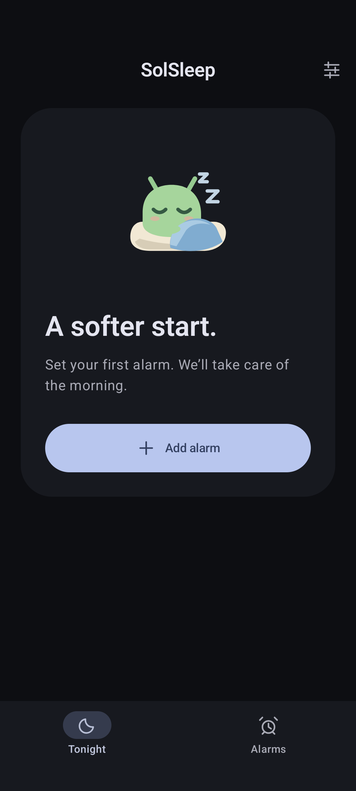 |
| Scheduled weekday alarm, API 37 | 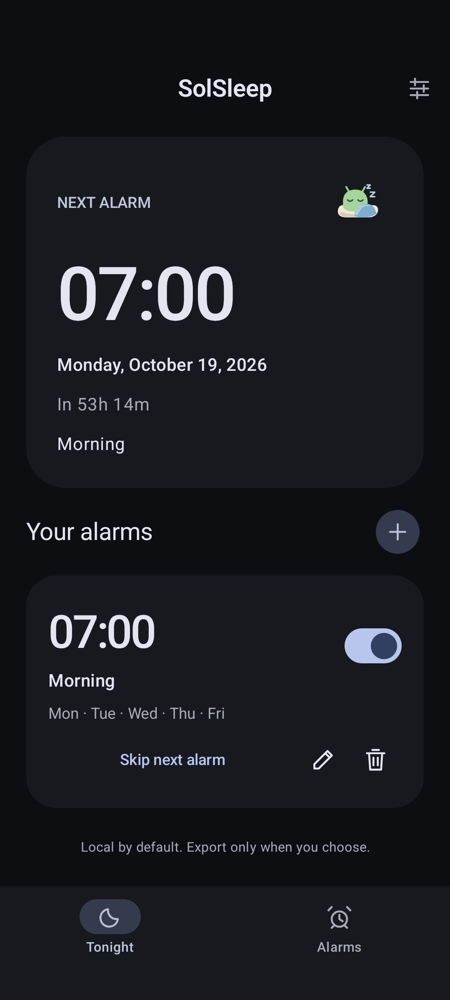 |
| Editor viewport, API 37 | 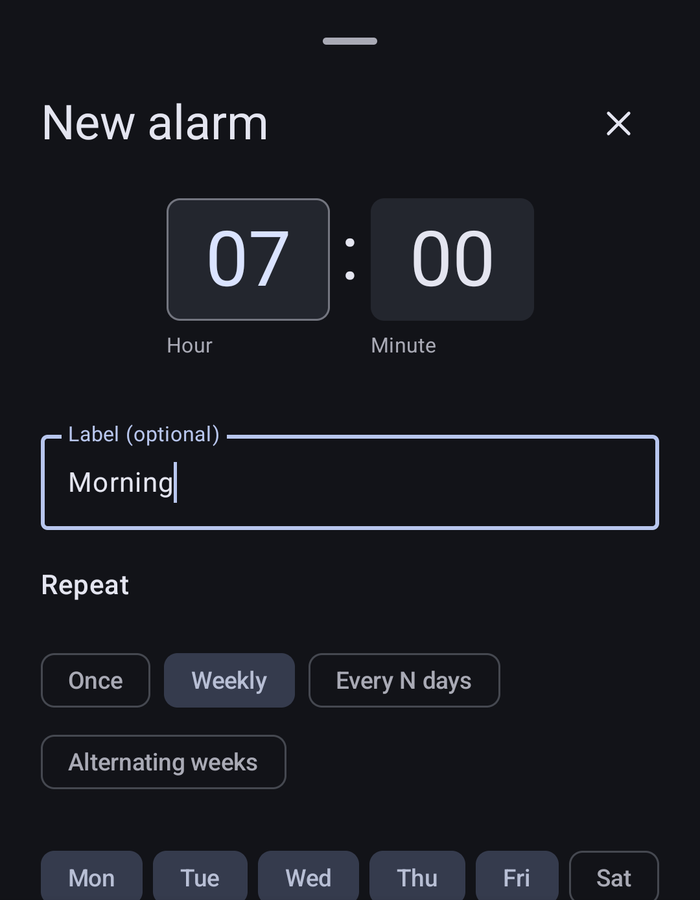 |
| 200% text, API 37 | 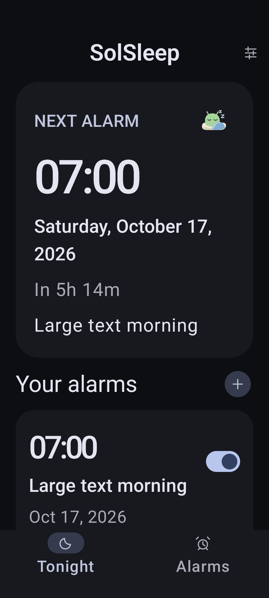 |
| First alarm, API 29 light fallback | 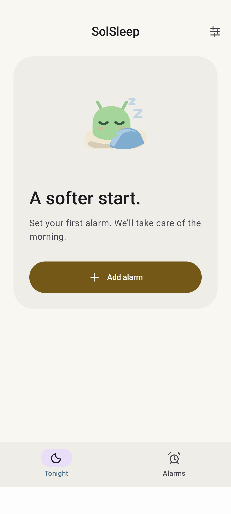 |

## Manual journal milestone

Final qualified source: `bf84199ddb61914f81adc968ac8179018cf35a49`.
[Run 39022166466](https://github.com/BananaJeanss/solsleep/actions/runs/39022166466)
contains actual final journal captures in both device-results artifacts, under
`app/build/outputs/connected_android_test_additional_output/`:

- `journal-night.png`: saved manual report after restoring an earlier correction.
- `journal-editor.png`: tag entry with fixed Save night/Cancel actions above the keyboard.
- `journal-large-text.png`: a real saved entry at 200% system text.

Labels and notes are synthetic test data. These are native app captures, not
image-model output. The earlier inline alarm images above retain their original
source attribution. The final qualified captures have now been copied into the repository.

| Screen | API 37 dark/dynamic | API 29 light fallback |
| --- | --- | --- |
| Saved report and correction history | 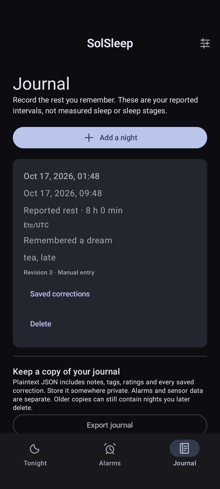 | 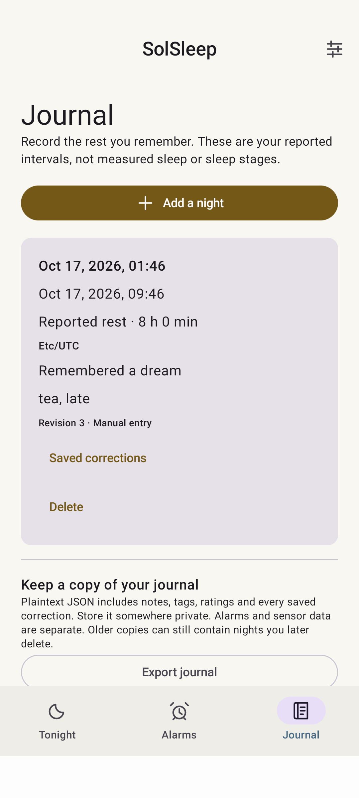 |
| Editor and keyboard | 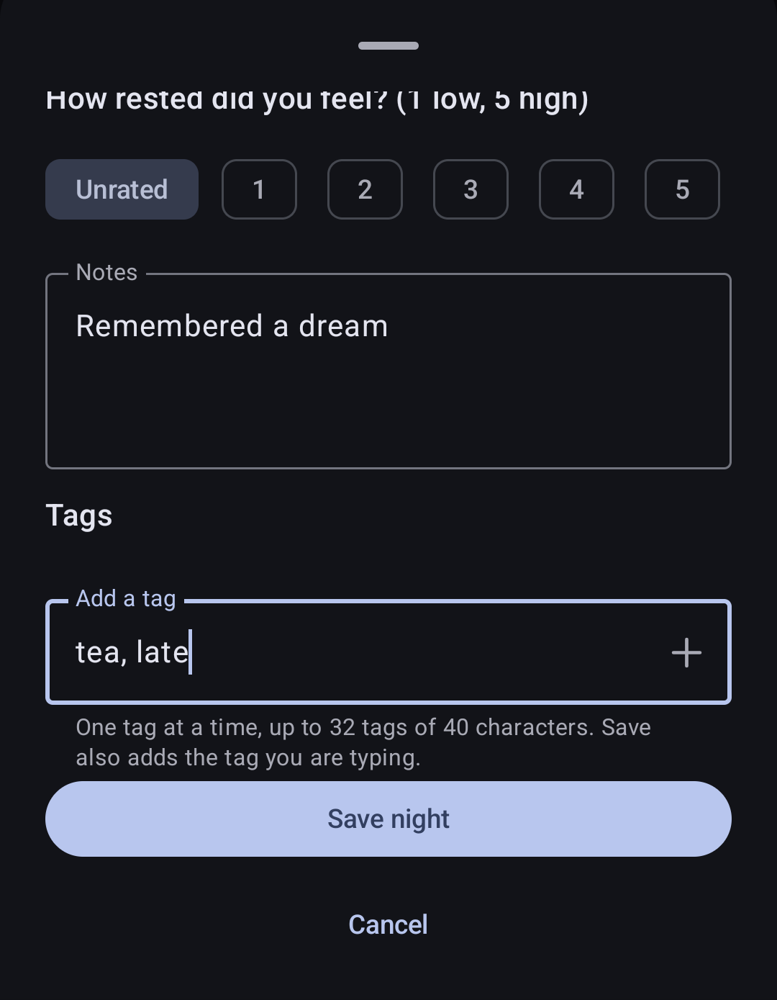 | 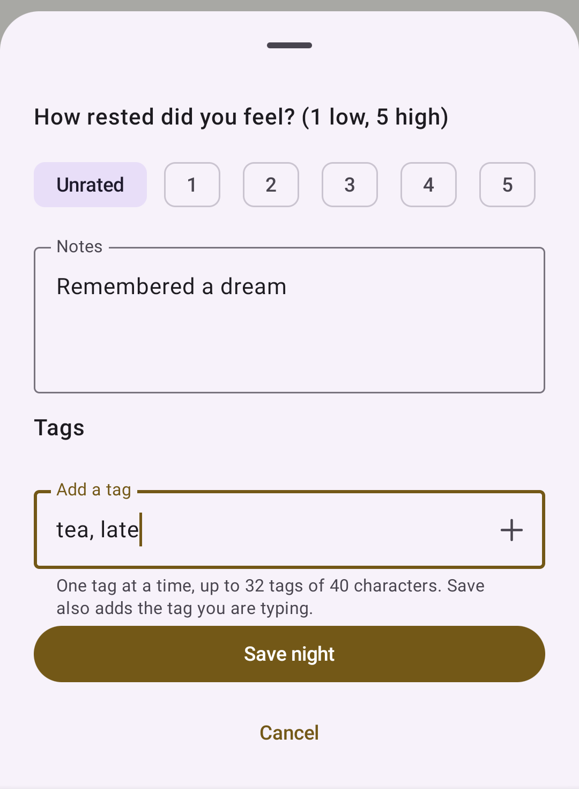 |
| Saved at 200% system text | 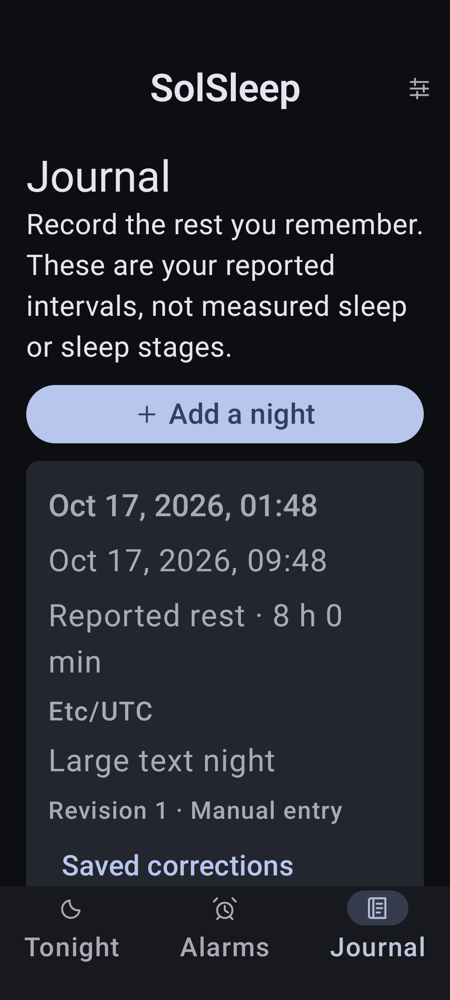 | 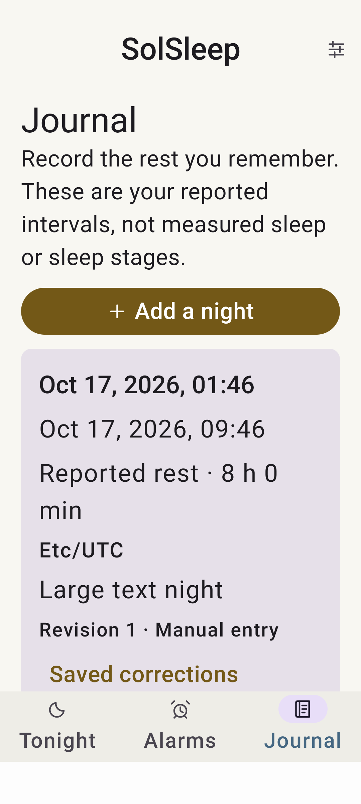 |

## Portable journal restore

Source `e123c46d2b745a016947952eeb152d28ebde9076`,
[CI21](https://github.com/BananaJeanss/solsleep/actions/runs/39033124196).
Both device-results artifacts contain `journal-restore-preview.png` and
`journal-restore-result.png`. These show a mixed live/deleted import, explicit
local-entry conflicts, real committed counts and the retained local night.
The source also moves alarm Save to a fixed footer; its captured alarm editor and
large-text workflow supersede the old alarm source for current layout evidence.

## Verified export outcomes

Source `271bfdb4f19f7e18f4fef6cc8851081a717a77fe`,
[CI24](https://github.com/BananaJeanss/solsleep/actions/runs/39041179253).
Both device artifacts include `journal-export-unverified.png` and
`journal-export-verified.png`, exercising the actual provider and visible outcome.
The same original night remains in storage. These captures show readback states,
not future cloud upload or retention guarantees.

## Persistent export history

Source `ddce75987f87bfbe1d5ce0647efc42ba111d1bf5`,
[CI30](https://github.com/BananaJeanss/solsleep/actions/runs/39043526164).
Both device artifacts contain `journal-export-history.png`; the actual light and
dark captures were reviewed. Last attempt and last verified receipt are distinct,
and the controlled provider copy contains the unchanged original journal. The
suite also asserts unavailable history is not rendered as known absence and
cannot block a verified recovery. No physical/remote-cloud guarantee is implied.

## Phone motion recording

Source `8c2460e33acab009308992ca33955a9b4c838406`,
[CI36](https://github.com/BananaJeanss/solsleep/actions/runs/39073894634),
merged in PR #7. These are exact copied PNGs from the passing native device
artifacts, reviewed in API 29 light and API 37 dark. They contain actual virtual
SensorManager observations, not generated human nights or image-model output.
The 200% test asserts the rendered Finished state, not just a database update.
The long screen/dialog scrolls; these captures show its current viewport.

| Screen | API 37 dark | API 29 light fallback |
| --- | --- | --- |
| Checked files and source counters | 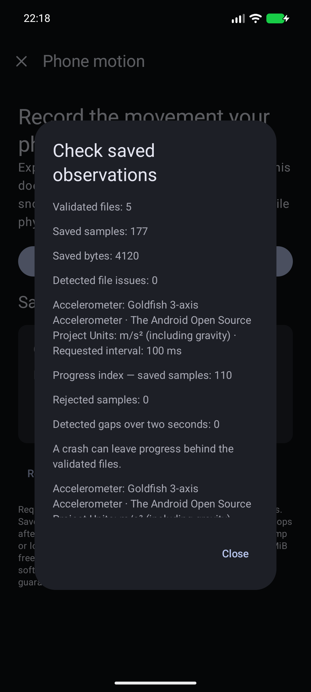 | 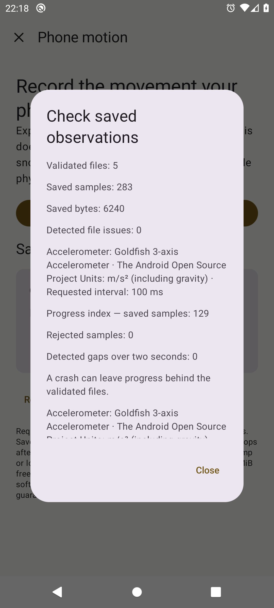 |
| Finished at 200% text | 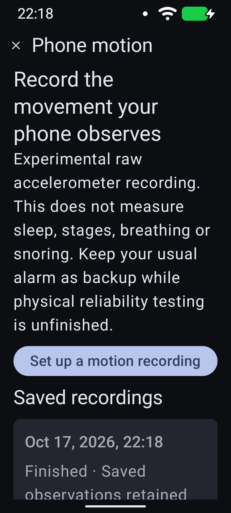 | 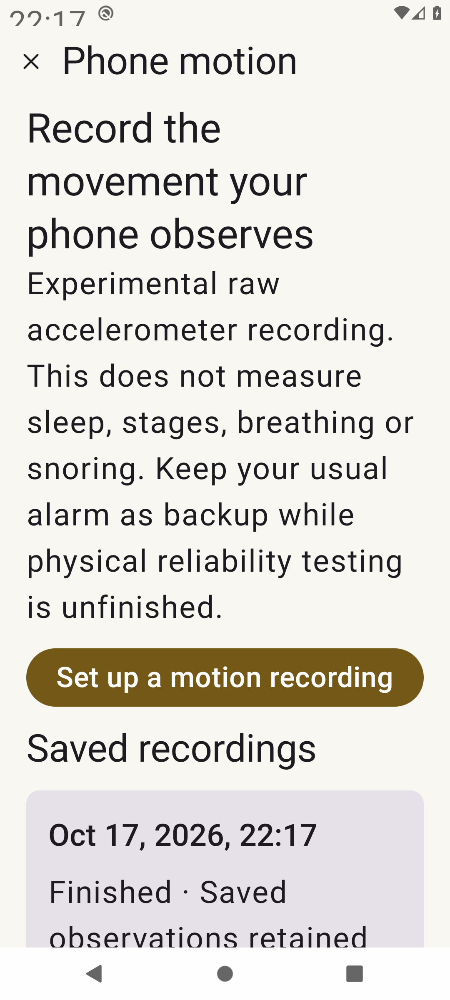 |

Counts differ between runs because samples are actually acquired. Requested
interval and original vectors/clock metadata are retained; these pictures do not
establish real mattress signals, sleep/stage accuracy or overnight energy.

## Finished-recording restore and export controls

Source `36ca8777a4f9b696af4f9cd632f2c99bb5b0e188`,
[CI39](https://github.com/BananaJeanss/solsleep/actions/runs/39076468922), PR #8.
These are exact copied native PNGs after provider staging, explicit restore,
complete SQL/raw readback and the visible enabled export control at 200% text.
They use a clearly named synthetic UI fixture, not a human sleep measurement.
The same suites retain actual virtual SensorManager callback cases separately.
Both captures were visually reviewed; the long backup explanation scrolls below
the current viewport. No image generation or screen reconstruction was used.

| Screen | API 37 dark | API 29 light fallback |
| --- | --- | --- |
| Restored recording, 200% text | 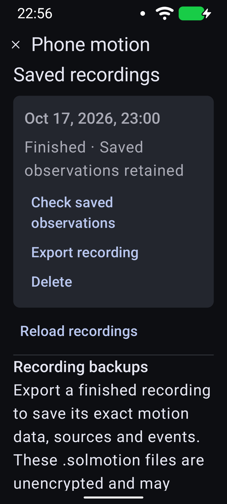 | 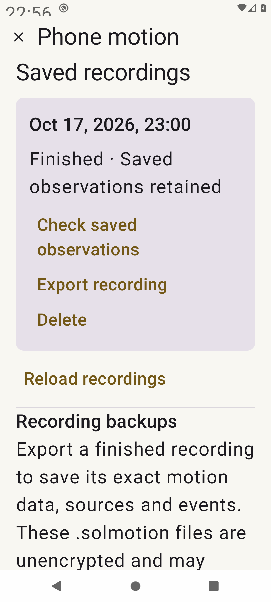 |
